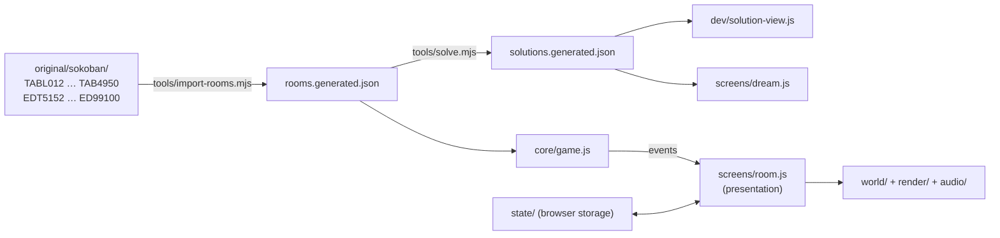

# Hening — Architecture

> **Status:** v1 · 2026-10-29 · owner: architect (Claude, chat)
> **Read with:** `GAME-DESIGN.md` (what the game does) and `ART-DIRECTION.md` (how it looks and sounds).
> This is the only document that describes the hidden solution viewer (§9). Do not mention it anywhere else: not in the UI, help text, README, comments visible to players, or other docs.

---

## 1. Principles

1. **Rules are pure.** `src/core/` knows nothing about Three.js, the DOM, audio or time. It takes a move and returns what happened. Everything you see and hear reacts to those events.
2. **Levels are data.** The game never contains a level in its source. Rooms come from a generated file built from the owner's copy of the original game (§4). Replacing the level set later means replacing one file.
3. **The reference is the quality bar.** `reference/index.html` is the art-directed truth. The game splits it into modules but must render the same pictures (§11).
4. **Zero raster.** No image or audio files in the game, except the two bundled fonts (`ART-DIRECTION.md` §1, §14).
5. **Works offline from disk.** The build is one HTML file that opens with a double-click.
6. **Humanized code.** Clear names, short functions, comments that explain *why*. Plain modern JavaScript with JSDoc types where they help. No frameworks.

---

## 2. Repository layout

```
retro-ports/sokoban/
├─ original/                 the owner's copy of the 1984 game (never committed)
├─ src/  src-game/           Gemini's decompile output: background reading only, not a dependency
├─ reference/index.html      the art-direction reference scene (quality bar; see §12 for git)
├─ docs/                     GAME-DESIGN.md, ARCHITECTURE.md, ART-DIRECTION.md
├─ prompts/                  build prompts, CLAUDE-CODE.md, run-agy.ps1, logs/
├─ review/                   everything the owner reviews (§13); generated
├─ .scratch/                 temporary renders, emptied after every prompt
├─ _archive/                 moved-aside old attempts (never deleted)
└─ game/                     the real game (a Vite project)
   ├─ package.json  vite.config.js  index.html
   ├─ src/assets/fonts/      Cormorant Garamond + Jost WOFF2, LICENSES.md (OFL); inlined by the single-file build
   ├─ src/
   │  ├─ main.js             boot, screen router
   │  ├─ core/               pure rules (no imports from outside core/)
   │  │  ├─ level.js         parse/serialize XSB, board helpers, validation
   │  │  ├─ game.js          game state, move, undo, restart, events
   │  │  ├─ replay.js        LURD strings ↔ move lists, replay + verify
   │  │  ├─ path.js          shortest free path for tap-to-walk
   │  │  └─ solver/          solver.js, deadlocks.js, matching.js, worker.js
   │  ├─ data/
   │  │  ├─ rooms.generated.json      the 50 rooms (generated, git-ignored)
   │  │  ├─ solutions.generated.json  verified solutions (generated, git-ignored)
   │  │  └─ rooms.js         loads the two files; falls back to a tiny built-in practice room
   │  ├─ render/             renderer.js, camera.js, pastel.js, water.js, moods.js, textures.js, island.js
   │  ├─ world/              wanderer.js, poses.js, fx.js, atmosphere.js
   │  │  └─ decor/           ponds.js, basin.js, fountain.js, gate.js, stranger.js, crows.js, index.js
   │  ├─ themes/             index.js (registry), lentera.js, … one file per theme
   │  ├─ audio/              sound.js (engine, reverb, ambience), instruments.js
   │  ├─ screens/            title.js, courtyard.js, elevator.js, floor.js, room.js, results.js,
   │  │                      pause.js, records.js, settings.js, garden.js, dream.js, ending.js
   │  ├─ ui/                 hud.css, hud.js, veil.js, dupa.js, icons.js (inline SVG)
   │  ├─ state/              progress.js, settings.js, garden.js (all browser storage, §8)
   │  └─ dev/                qa.js (window.hening, §10), solution-view.js (§9)
   ├─ tools/                 Node scripts (§5, §13): import-rooms.mjs, solve.mjs, review.mjs,
   │                         shoot.mjs, regress.mjs, flow.mjs, perf.mjs
   └─ tests/                 Vitest: level, game, replay, path, solver, importer
```

`src-game/assets/levels/*.xsb` and `all_*_levels.txt` are **not used**. They were extracted with the wrong file names: levels 1–4 are missing and the "editor levels" are empty stubs (§4.2).

---

## 3. Data flow



`npm run rooms` runs the importer and the solver. `npm run dev` and `npm run build` run the importer first if `rooms.generated.json` is missing.

---

## 4. Rooms: the importer

### 4.1 The original files

The 1984 game stores two rooms per 612-byte file. The real file names are:

| Rooms | Files (in order) |
|---|---|
| 1–10 | `TABL012`, `TABL034`, `TABLE56`, `TABLE78`, `TABL910` |
| 11–50 | `TAB1112`, `TAB1314`, … `TAB4950` (two-digit pairs) |
| Editor slots 51–100 | `EDT5152`, `EDT5354`, … `EDT9798`, `ED99100` |

Each 306-byte record:

| Bytes | Meaning |
|---|---|
| 0–1 | Start position, little-endian `uint16`: `row × 19 + col` |
| 2–305 | 16 rows × 19 columns, one byte per cell, row-major |

| Byte | Cell |
|---|---|
| `0x00` | floor (or outside) |
| `0x01` | wall |
| `0x02`, `0x14` | object |
| `0x03` | target |
| `0x04`, `0x23` | object on target |
| anything else | error: stop and report the file and offset |

If the start position is on a target, the cell is "wanderer on target".

### 4.2 What is actually there (verified 2026-10-29)

- All 50 rooms decode cleanly; in every room objects = targets; the largest has 32 objects.
- All 50 editor slots are **empty** (no walls). The editor therefore starts with 50 empty garden slots (§8). The importer still reads them, and if a future copy has filled slots, seeds the garden with the valid ones.

### 4.3 Output

`game/src/data/rooms.generated.json`:

```json
{
  "source": "original/sokoban (1984)",
  "generated": "2026-10-29T12:00:00Z",
  "rooms": [
    { "number": 1, "floor": 1, "file": "TABL012", "record": 0,
      "rows": ["    #####", "    #   #", "..."], "objects": 6 }
  ],
  "garden": []
}
```

- `rows` is trimmed XSB: `#` wall, ` ` floor, `.` target, `$` object, `*` object on target, `@` wanderer, `+` wanderer on target. Blank rows and columns around the room are removed; trailing spaces trimmed.
- The importer locates `original/sokoban/` relative to the repo; `--source <dir>` overrides.
- If the folder is missing, it writes nothing and prints how to provide it. The game then runs with its one built-in practice room (a tiny room written by us, not taken from the original) so it never crashes.

### 4.4 Legal line

The generated files, anything that shows original rooms (screenshots, review sheets), and the built game contain the original room layouts. They are for the owner's personal use and are git-ignored (§12). Unit tests use small rooms written by us; tests that need the real rooms run only when `original/` is present and are skipped otherwise.

---

## 5. Core rules (`src/core/`)

### 5.1 Level

`parseLevel(rows) → Level`: dimensions, `wall[][]`, `inside[][]` (flood fill from the start through non-wall cells, exactly as the reference), `targets`, `objects`, `start`. `validateLevel(level) → { ok, problems[] }` with Indonesian messages for the editor (`GAME-DESIGN.md` §7.8).

### 5.2 Game

```js
const game = createGame(level);
game.move('up' | 'right' | 'down' | 'left') // → MoveResult
game.undo()                                  // → UndoResult | null
game.restart()                               // one history entry (undoable)
game.state        // { player, objects[], steps, pushes, solved }
game.history      // compact: one entry per move, enough to undo
game.toLurd()     // the moves so far as a LURD string
```

`MoveResult` is the contract with the presentation:

| `kind` | Payload | Presentation (from the reference) |
|---|---|---|
| `walk` | from, to, dir | walk/run step |
| `push` | from, to, dir, objectIndex, objectFrom, objectTo, `lit: targetIndex | null`, `unlit: targetIndex | null` | push step, chime / muffled note |
| `blocked-wall` | dir | bump |
| `blocked-object` | dir, objectIndex | protest, or shrug if blocked again within 3.5 s (timing lives in the presentation, not the core) |
| `solved` | steps, pushes | appended to the result of the move that solved the room |

Directions are **grid** directions. Screen-relative mapping (camera rotation) lives in the presentation (`ART-DIRECTION.md` §3.1).

Targets carry a stable `index` in reading order (row by row, left to right) so the presentation can give each its note (`ART-DIRECTION.md` §7.6).

### 5.3 Replay

LURD notation: `l u r d` = walk, `L U R D` = push. `replayLurd(level, lurd) → { ok, solved, steps, pushes, failedAt }`. Every solution the game ever stores or shows is verified with this first.

### 5.4 Path

`findPath(game, target) → dirs[] | null`: breadth-first search around walls and objects, as in the reference, for tap-to-walk.

---

## 6. The solver (`src/core/solver/`)

Used twice: offline in Node for the 50 rooms (`tools/solve.mjs`), and in a Web Worker for garden rooms (§9.3). One implementation.

### 6.1 Algorithm

- **Search over pushes**, not steps. A node = the set of object cells + the *normalized* wanderer position (the smallest reachable cell index). Moves between pushes are recovered at the end by `findPath`.
- **Best-first / weighted A\*** with `f = g + w·h`, `g` = pushes so far, `w` = 1 first, then 2 and 3 on retries if the budget runs out. Report which weight found each solution.
- **Heuristic `h`:** minimum-cost matching of objects to targets (Hungarian algorithm, `matching.js`), where the cost is the push distance from a cell to a target on the empty board (precomputed by reverse "pull" BFS from each target).
- **Dead cells:** cells from which no target can be reached by pushes (reverse pull reachability). An object on a dead cell prunes the node.
- **Freeze deadlocks:** an object blocked on both axes by walls or other frozen objects, not on a target, prunes the node. Include the 2 × 2 block pattern.
- **Tunnels and goal-room ordering:** optional optimizations, add them only if rooms stay unsolved.
- **Transposition table:** Zobrist hashing (two 32-bit halves) of object cells + normalized wanderer.
- Deterministic: no randomness, same answer every run.

### 6.2 Budgets and output

| Where | Budget per room | On failure |
|---|---|---|
| `tools/solve.mjs` | 120 s and 6 M nodes at `w = 1`; then retry with `w = 2`, `w = 3`; up to 10 min total per room | Listed as unsolved in the report |
| Web Worker (garden) | 20 s | "belum ditemukan" (§9.3) |

`solutions.generated.json`:

```json
{ "generated": "…", "solutions": { "1": { "lurd": "ullluu…", "steps": 97, "pushes": 33, "weight": 1, "ms": 412 } } }
```

Every entry is verified by `replayLurd` before it is written. The tool prints a table (room, solved, steps, pushes, weight, ms) for the prompt summary.

`solutions.manual.json` (owner-supplied LURD strings) is merged in for rooms the solver could not solve, after the same verification. **Owner's decision (2026-10-30):** these may come from the web or from other models the owner names, each verified by `replayLurd` on our own room and stored with its source. Since 2026-10-30 all 50 rooms have a verified solution (solver plus manual). Game code reads both files through one module, `data/solutions.js`.

---

## 7. Presentation

### 7.1 From the reference to modules

The reference is one file on purpose. The game splits it without changing any number:

| Reference section | Game module |
|---|---|
| 1 Moods, 4 pastel material, 5 textures, 7 renderer/camera, 8 mood transitions | `render/moods.js`, `render/pastel.js`, `render/textures.js`, `render/renderer.js`, `render/camera.js` |
| 9 Atmosphere | `world/atmosphere.js` |
| 10 Board → island | `render/island.js` (geometry only; reads a `Level`) |
| 11 Pedestals and lanterns | `themes/lentera.js` (object, target, lit effect, instrument, labels) |
| 12 Wanderer, poses | `world/wanderer.js`, `world/poses.js` |
| 13 Effects | `world/fx.js` |
| 13b–13f Water, gate, stranger, crows, decor | `world/decor/*.js` |
| 6 Sound | `audio/sound.js`, instruments move to the theme files |
| 14 Game state and rules | replaced by `core/game.js` + `screens/room.js` (the event → animation glue, the script runner for arrival/departure) |
| 15 Input | `screens/room.js` + a small `ui/input.js` |
| 16 Reference panel | not in the game (QA hooks replace it, §10) |
| 18 `window.hening` | `dev/qa.js` (same API and more) |

### 7.2 Themes

```js
registerTheme({
  id: 'lentera', name: 'Lentera', counterLabel: 'lentera', solvedLine: 'Semua lentera menyala',
  accent: null,                                // null = use the mood glow as is
  createObject() → ThemeObject,                // { group, body, setLit(on), update(dt, t, glow), nudge(dx, dz, k) }
  createTarget() → ThemeTarget,                // { group, update(dt, t, glow, covered) }
  roomExtras?(level, group) → { update(dt, t, progress) },  // floor variants, progressive water…
  instrument: { play(freq, when, level), mute(freq) },
  pushSound(sound),
  scale: null,                                 // null = pentatonic table; Candi provides slendro
});
```

The room asks the registry for the current theme from settings. Adding a theme = one new file + one import line in `themes/index.js`.

**Instancing (from prompt 04).** To keep a room within the draw-call budget (§14), theme objects and targets are drawn as one `InstancedMesh` per part per room (`render/instances.js`), with a per-instance `glowAmt` attribute in the pastel shader. A theme therefore declares its object and target as **parts** — `{ geometry, role/colour, glows: bool, transform }` — and the instancing layer builds and updates them. The per-object handle the room uses (`group`, `setLit`, `update`, `nudge`) is unchanged: `group` is a light `Object3D` whose matrix is copied into its instances when it changes. Effects that cannot be instanced (rising water, raked sand) live in `roomExtras`.

### 7.3 Screens

A tiny router: each screen module exports `enter(ctx, params)`, `update(dt, t)`, `exit()`, and handles its own input. One renderer, one scene graph per screen, one shared audio engine. Transitions are veil fades (`ART-DIRECTION.md` §9, §13).

---

## 8. Browser storage

All reads and writes wrapped in `try/catch`; on failure the game keeps state in memory.

| Key | Content |
|---|---|
| `hening.progress.v1` | `{ open: n, solved: { [room]: { dupa?: Rec, bebas?: Rec } }, assisted: [room…], floorsLit: [n…], ending: bool, lastRoom }` with `Rec = { steps, pushes, timeMs? }` |
| `hening.settings.v1` | `{ theme, mode, dupaMinutes, volume: { master, ambience, notes }, reducedMotion: 'system'|'on'|'off', hints }` |
| `hening.garden.v1` | `{ slots: [ { rows, name?, tested: bool, record?: Rec } | null ] × 50 }` |

`assisted` lists rooms solved in an attempt where the solution viewer was opened (§9.2). Write a version number in each object; on an unknown version, keep the old data under `….bak` and start fresh.

---

## 9. The hidden solution viewer

Purpose: let the owner check that a room can be won, without telling players it exists.

### 9.1 Opening it

- **Ctrl + Alt + C** in a room (`event.code === 'KeyC' && event.ctrlKey && event.altKey`; matching on `code` makes it work on layouts where Ctrl + Alt is AltGr). Press again or Esc to close.
- Not available on the title, courtyard, floors or editor screens. Never listed anywhere in the UI, the help, the hint line, settings, or any README. In code, keep it in `dev/solution-view.js` with a plain comment saying what it is. Unlike the QA hooks, it ships in the normal build (no `?qa=1` needed), because the owner uses it while playing.

### 9.2 What it does

1. Freezes the player's own attempt (state, history, timer) and dims the HUD.
2. Shows the room **from its start** with a dream wanderer (the Mimpi look, `ART-DIRECTION.md` §13.9) performing the stored solution, plus a small veiled control strip at the bottom: `‹ langkah 41 / 128 ›`, ▶ / ❚❚.
3. Controls: → next step, ← previous step, Space play/pause (4 steps/s), Home back to the start, Esc close.
4. On close, the player's attempt is restored exactly, timer included (time does not burn while the viewer is open).
5. If the player then solves the room in the same attempt, the room is recorded in `assisted`: it **does** open the next room (so the owner can test progression), but sets **no record**.

### 9.3 Rooms without a stored solution

For garden rooms (and any room missing from `solutions.generated.json`) the viewer starts the solver in a Web Worker: the strip shows "mencari jalan…" breathing; on success it plays like §9.2 and caches the solution with the slot; after 20 s it shows "belum ditemukan dalam 20 detik" and an option to keep searching for another 60 s.

---

## 10. QA hooks (`dev/qa.js`)

Enabled when the URL has `?qa=1` (dev and build). Exposes `window.hening`, a superset of the reference API (`ART-DIRECTION.md` §0), so the same screenshot scripts work on both:

| Call | Effect |
|---|---|
| `start()`, `setMood(i)`, `rotate(±1)`, `closeUp(z)`, `focus(x, z, zoom)`, `face(d)`, `scrub(name, t, step)`, `arrange(n)`, `skipIntro()`, `where()`, `decor`, `state` | as in the reference |
| `room(n)` | open room *n* (1–50) directly, skipping unlocks |
| `level(i)` | reference compatibility: `level(0..2)` opens rooms 5, 6, 7 |
| `screen(name, params)` | jump to `title`, `courtyard`, `elevator`, `floor`, `results`, `pause`, `records`, `settings`, `garden`, `dream`, `ending` |
| `theme(id)` | switch theme |
| `progress(json)` | load a progress object (e.g. "rooms 1–23 solved") |
| `solve()` | play the stored solution at full speed (for flow tests) |
| `freezeTime(on)` | stops all time-based motion (clouds, koi, crows, flicker) for stable regression frames |

The fixed-seed rule: with `?qa=1&seed=N`, every random choice (koi start, crow timers, stranger seat, cloud placement) uses a seeded generator so frames are reproducible. The reference uses `Math.random`; regression compares framing, palette and poses, not cloud positions (§11).

---

## 11. Testing

| Layer | Tool | What |
|---|---|---|
| Core | Vitest (`npm test`) | parse/validate, every move kind, undo/restart, LURD replay, path, solver on our own small rooms, importer on a synthetic 612-byte file |
| Rooms | `tools/solve.mjs` | all 50 rooms solved and verified |
| Flow | `tools/flow.mjs` (Playwright) | title → courtyard → tower → room 1 → solve → results → next room; storage on and off |
| Look | `tools/regress.mjs` | game vs reference, side by side, same states (§13) |
| Perf | `tools/perf.mjs` | frame time in room 6 (all lit) and the largest room |

Playwright uses `playwright-core` with the installed Edge (`channel: 'msedge'`) or Chrome, like the other ports. WebGL in headless Chromium needs `--use-gl=angle --use-angle=swiftshader --enable-unsafe-swiftshader` when no GPU is available.

---

## 12. Build and git

- Vite, `three@0.170.0` pinned exactly, `vite-plugin-singlefile` so `npm run build` writes **`game/dist/hening.html`**: one file with the code, the fonts (as data URIs) and the generated rooms inlined. It opens from disk with no server and no network.
- `npm run dev` for development; `?qa=1` works in both.
- Nothing is committed or pushed unless the owner asks.
- `.gitignore` (in `retro-ports/`), add:

```
# Hening: anything that contains the original rooms stays local
sokoban/game/src/data/*.generated.json
sokoban/game/src/data/solutions.manual.json
sokoban/game/dist/
sokoban/game/node_modules/
sokoban/review/
sokoban/.scratch/
```

  `sokoban/reference/` stays ignored by the existing `*/reference/` rule: unlike Spyder's, it embeds three original rooms.

---

## 13. Where images go

The owner reviews in **one** place: `sokoban/review/`.

```
review/
├─ index.html                     the gallery (rebuilt by `node tools/review.mjs gallery`)
├─ reference/                     quality-bar frames rendered from reference/index.html
├─ current/<target>/<state>.jpg   latest frame per screen/room/theme
└─ prompts/<NN-name>/             exactly one sheet.jpg + one summary.md per prompt
```

- Temporary renders go to `sokoban/.scratch/<tool>/` and are deleted at the end of every prompt.
- `node tools/review.mjs audit` lists every image under `sokoban/` outside `review/`, `.scratch/`, `original/`, `src/`, `src-game/`, `_archive/` and `node_modules/`; it must print nothing.
- Sheets: 1920 px wide, two columns of 960 × 540 cells, JPEG quality 80, each cell captioned (Jost, `ink` on the mood veil).
- The gallery: newest prompt first (sheet + rendered summary), then current frames by target, then the reference row labelled "quality bar". Opens from disk.

---

## 14. Performance budget

| Item | Budget |
|---|---|
| Frame time | ≤ 8 ms CPU+GPU on a mid laptop in room 6, all objects lit; 60 fps |
| Draw calls | ≤ 150 in a room (merge static geometry per role, as the reference does) |
| Build size | `hening.html` ≤ 3 MB |
| Load | interactive in ≤ 1.5 s from disk |
| Memory | dispose geometry and materials on every room change; no growth after 20 room changes |
