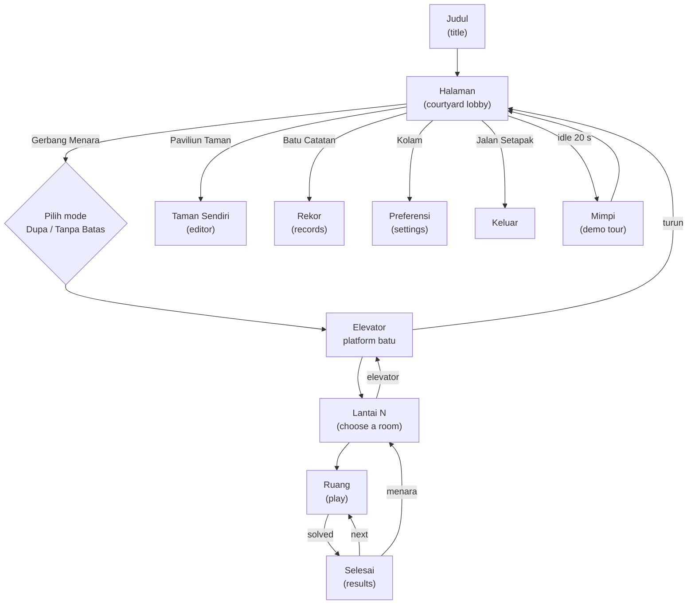

# Hening — Game Design

> **Status:** v1 · 2026-10-29 · owner: architect (Claude, chat)
> **Read with:** `ART-DIRECTION.md` (how everything looks and sounds) and `ARCHITECTURE.md` (how it is built).
> When this document and the owner disagree, the owner wins and this document gets fixed.

Hening is a zen remake of the 1984 warehouse puzzle *Soko-Ban*. The rules are the classic ones. Everything around them is new: a wanderer in a floating pastel world lights stone lanterns, room by room, up a tower above the clouds.

This port is for the owner's **personal use**. It plays the 50 original rooms read from the owner's own copy of the game (see `ARCHITECTURE.md` §4). Nothing here redistributes the original.

---

## 1. Decisions already made

| Topic | Decision |
|---|---|
| Name | **Hening** |
| Look | Monument Valley *style* only (isometric pastel, calm). No impossible-geometry mechanics in this version |
| Rules | Classic: push one object at a time, never pull, all targets covered = solved |
| Rooms | The 50 original rooms, in their original order |
| Structure | 5 floors × 10 rooms; rooms unlock in order |
| Players | One. No multiplayer |
| Modes | **Dupa** (incense timer) and **Tanpa Batas** (no time limit) |
| Kept from 1984 | Timer, level editor, demo tour, records |
| Themes | Five themes, chosen by the player as a preference (§6) |
| Music | Each target plays a note of a pentatonic scale; a solved room ends on a chord |
| Language | All player-facing text in Indonesian; code and docs in English |

---

## 2. The rules

The board is a grid. Cells are floor, wall, target, object, or the wanderer.

- The wanderer moves one cell up, right, down or left.
- Moving into an object pushes it one cell, if the cell behind it is floor or target and holds no other object.
- An object cannot be pulled. Two objects cannot be pushed at once.
- The room is solved the moment every target holds an object.
- **Undo** steps back one move, without limit, back to the start of the room. **Restart** returns to the start in one step. A restart is itself one history entry, so one undo right after an accidental R brings the whole position back.
- Inner walls that are drawn as ponds, basins or fountains are walls to the rules (`ART-DIRECTION.md` §10b). Decoration never changes a move.

**Counters:** *langkah* (moves, including pushes) and *dorongan* (pushes). Undo restores both to what they were before the move. These are the only scores.

---

## 3. Controls

| Action | Keyboard | Pointer / touch |
|---|---|---|
| Move | ← ↑ → ↓ or A W D S (screen-relative, `ART-DIRECTION.md` §3.1) | Tap a reachable floor tile: the wanderer walks there by the shortest free path (runs if longer than 2 tiles) |
| Push | Move into the object | Tap an object next to the wanderer |
| Undo | Z or Backspace | Undo button |
| Restart room | R | Restart button |
| Rotate view | Q / E | Rotate button |
| Pause | Esc or P | Pause button |
| Sound on/off | M | Sound button |
| Confirm in menus | Enter or Space | Tap |
| Skip an arrival or a cut-scene | Any move key, Space, tap | Tap |

One move may be buffered while a step is in flight. Input is never blocked by an animation.

---

## 4. Structure of the world

### 4.1 Floors and rooms

| Floor | Rooms (original numbers) | Mood across the floor |
|---|---|---|
| Lantai I | 1–10 | Fajar → Malam (`ART-DIRECTION.md` §5.3) |
| Lantai II | 11–20 | same day cycle |
| Lantai III | 21–30 | same |
| Lantai IV | 31–40 | same |
| Lantai V | 41–50 | same |

- The HUD place line reads `LANTAI II · RUANG 14` (the room's original number, two digits).
- Room 1 is open at the start. Solving room *n* opens room *n + 1*. Solving room 10 also opens floor II, and so on.
- Any solved room can be replayed at any time. Replays can improve records.

### 4.2 Gamification (quiet on purpose)

Hening rewards attention, not grinding. There are no coins, no stars, no streaks.

| Reward | When | What the player sees |
|---|---|---|
| A light in the tower | Room solved | That room's niche on its floor stone holds a lit object for good |
| A ring of light | All 10 rooms of a floor solved | A thin ring of light along the floor stone's rim; seen from the courtyard as a lit ring floating in the stack; a deep bell |
| Records | Better moves or pushes than before | The record stone (Batu Catatan) gains an engraving; the results card says `rekor baru` |
| Ending | All 50 rooms solved | §8 |

---

## 5. Modes

The mode is chosen at the Gerbang Menara each time the player goes up (the last choice is pre-selected).

| | **Dupa** | **Tanpa Batas** |
|---|---|---|
| Time | An incense stick burns per room. Default 20 minutes; 10 / 20 / 30 selectable in Kolam | None |
| When time runs out | The ember goes dark, "dupa telah padam"; choose *ulangi* (restart the room) or *kembali ke menara*. Nothing is lost | — |
| Undo / restart | Allowed; time keeps burning; restart lights a fresh stick | Allowed |
| Pause | Stops the stick | — |
| Records | Kept separately: moves, pushes and **time** | Moves and pushes |
| Unlocking | Either mode unlocks the next room | Either mode |

---

## 6. Themes (player preference)

Chosen at the Kolam in the courtyard, applied to the whole game, saved. All themes share rules, rooms, camera and moods; they change the object, target, lit effect, instrument and the solved-room line. Full specs in `ART-DIRECTION.md` §7.

| Theme | Object → target | Solved line |
|---|---|---|
| **Lentera** (default) | Stone lantern → pedestal | Semua lentera menyala |
| **Cahaya Bintang** | Star crystal → altar | Semua kristal bercahaya |
| **Taman Batu** | Runic monolith → balance point | Taman telah seimbang |
| **Candi** | Stupa stone → terrace socket | Semua stupa bersinar |
| **Mata Air** | Channel plug → leak hole | Mata air telah pulih |

The HUD counter label follows the theme (`lentera`, `kristal`, `batu`, `stupa`, `mata air`).

---

## 7. Screens

### 7.1 Judul (title)
The whole tower in morning cloud, the wanderer meditating at its foot, "Hening" large, "ketuk untuk mulai". First gesture starts the audio and descends into the courtyard (`ART-DIRECTION.md` §13.1).

### 7.2 Halaman (courtyard lobby)
The wanderer walks; there is no menu. Five places (`ART-DIRECTION.md` §13.3):

| Place | Does |
|---|---|
| Gerbang Menara | Mode choice, then the elevator up. Goes straight to the floor of the next unsolved room |
| Paviliun Taman | Opens the editor (§7.8) |
| Batu Catatan | The records card (§7.9) |
| Kolam | Preferences (§7.10) |
| Jalan Setapak | Leaves the game (back to the title; later, to the collection Hall) |

Number keys 1–5 walk to the places in this order. Idle for 20 s starts Mimpi (§7.7).

### 7.3 Elevator
A round stone platform rises along the axis of the floating stones, through their openings; each stone settles a little as it passes (`ART-DIRECTION.md` §13.4). 3.2 s per floor. Going down to the courtyard is the same ride in reverse. Any key skips the ride.

### 7.4 Lantai (floor = room choice)
The floor stone with ten niches on its rim. ← / → (or tap) moves between niches; Enter enters; ↑ / ↓ rides the elevator to the floor above or below (only to floors that are open); Esc goes down to the courtyard. Niche states: locked, open, solved, current (`ART-DIRECTION.md` §13.5). A small caption under the current niche shows the room number and, if solved, the best moves and pushes for the current mode.

### 7.5 Ruang (play)
Exactly the reference scene: arrival through the torii gate, play, bow, departure through the gate, results.

### 7.6 Selesai (results)
Veiled overlay after the departure: the theme's solved line, `128 langkah · 41 dorongan` (plus `12:40` in Dupa), `rekor baru` when a record falls, and three choices: **ruang berikutnya** (Enter; if open), **ulangi**, **menara** (back to the floor). After the last room of a floor, *ruang berikutnya* first plays the elevator up.

### 7.7 Mimpi (demo tour)
After 20 s idle in the courtyard, a dream wanderer plays a stored solution of a room the player has already seen (room 1 if none), at a calm 4 steps per second, in that room's mood. Any input wakes the player in the courtyard.

### 7.8 Taman Sendiri (editor)
Fifty personal garden slots, stored on this device. The original game's editor slots were empty, so the player starts with 50 empty slots.

- **Slot list:** a scroll of 50 small plaques; empty ones read `kosong`.
- **Editing:** the room shown in the play camera with a grid. Tools: *lantai*, *dinding*, *objek*, *target*, *awal* (start), *hapus*. Board up to 19 × 16 cells (the original limit).
- **Rules shown while editing:** objects = targets; exactly one start; the start can reach every floor tile it needs (enclosed by walls). A slot that breaks a rule can be saved but not played; the problem is named in one line (`jumlah objek dan target belum sama`).
- **Coba (try):** plays the slot as a normal room; returning restores the editor exactly. Solving it marks the slot `teruji` (tested).
- **Bermain:** rooms in the garden are played from the slot list, any order, Tanpa Batas only, with their own records.
- Walls the player paints inside the room become ponds and basins exactly like in the tower (decor rules are shared).

### 7.9 Batu Catatan (records)
A stele card: for each floor, ten rows: room, best moves, best pushes, and in Dupa also best time. Toggle Dupa / Tanpa Batas. Unsolved rooms read `—`.

### 7.10 Kolam (preferences)

| Setting | Values | Default |
|---|---|---|
| Tema | the five themes (only those built so far are selectable) | Lentera |
| Mode awal | Dupa / Tanpa Batas | Tanpa Batas |
| Panjang dupa | 10 / 20 / 30 menit | 20 |
| Suara | master, ambience, nada (sliders) | 80 / 60 / 80 |
| Gerak halus | on / off (reduced motion) | follows the system setting |
| Petunjuk tombol | show the hint line in rooms | on |

### 7.11 Jeda (pause)
`ART-DIRECTION.md` §13.8: *lanjutkan · ulangi ruang · kembali ke menara · suara*.

---

## 8. Ending

When the 50th room is solved, the results card offers only **naik** (go up). The platform rises past the last floor to the capstone (`ART-DIRECTION.md` §13.12). The wanderer steps onto it and the last light comes on. Every niche of the tower glows. The wanderer walks to the capstone's edge and sits; the figure in black (`ART-DIRECTION.md` §10b.3) is already sitting there, and turns its head toward the wanderer. The camera pulls back to the whole stack of stones; hold for 6 s, slow fade to the Fajar sky, the word "Hening", then the courtyard. The stranger never speaks.

---

## 9. Persistence

Progress, records, preferences and the garden are kept on this device (browser storage). The game must still run when storage is unavailable; it then simply forgets on reload. There is no account and no network. Details: `ARCHITECTURE.md` §8.

---

## 10. Out of scope for this version

- Impossible-geometry mechanics (a later "B" version).
- Multiplayer, online records, accounts.
- A collection Hall (Jalan Setapak returns to the title for now).
- Publishing: the original rooms are personal use only (`ARCHITECTURE.md` §4.4).
