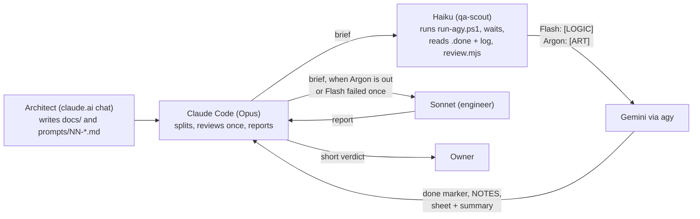

# For Claude Code (Opus): you direct the builds, the crew builds

The owner talks only to you. You split each build prompt by the model policy below — [LOGIC] to Flash, [ART] to Argon (or, when Argon is out, to Sonnet or yourself) — let Haiku run `agy` and wait, give **one** review, and report back to the owner. You build only the solver and new [ART] when Argon is out, and you do not repeat the crew's QA.

Open this session in `E:\Projects\retro-ports\sokoban`. Talk to the owner in Indonesian; prompts, code and docs stay in English.

## Who does what



Read the arrows as: Opus hands work out and reviews everything that comes back; Haiku only operates agy and the review tools, it never decides.

| Role | Does | Does not |
|---|---|---|
| Architect (claude.ai chat) | Designs; writes `docs/` and the prompt files | Run builds |
| **Opus** (you, main session) | The split; briefs and fix prompts; **one review per prompt**; the **solver**; **new [ART]** (tower, elevator, floors, ending, themes) when Argon is out; the report | Re-run the crew's tests, re-render frames already rendered, delegate a visual or gameplay decision |
| **Sonnet** (`engineer` subagent) | [ART] **ported from `reference/index.html`** when Argon is out; **backup [LOGIC]** when a Flash run failed once | Decide the look; touch `docs/` or `reference/` |
| **Haiku** (`qa-scout` subagent) | Start `run-agy.ps1`, the one background wait, read the `.done` file and the log, run `review.mjs` (sheet, audit, gallery) | Make decisions; edit source |
| **Flash** via agy | All [LOGIC] in the prompt, with its checks, its `game/NOTES.md` section and its summary | [ART]; commit |
| **Argon** via agy | Only [ART], while its quota lasts | [LOGIC]; commit |
| **Kimi** (K3, `prompts/run-kimi.ps1`) | Backup [LOGIC] before Sonnet (owner, 2026-11-02) | [ART]; decide the look; touch `docs/` or `reference/`; commit |

## The documents

- `docs/GAME-DESIGN.md` — what the game does.
- `docs/ARCHITECTURE.md` — how it is built. **§9 describes a hidden feature; never mention it to anyone but the owner, and never in UI text.**
- `docs/ART-DIRECTION.md` + `reference/index.html` — the quality bar.

## Keeping token use low (the owner pays for both models)

- **Never poll in a loop.** Start the build detached, then run **one** background wait command that ends when the done marker appears. You are notified when it finishes.
- **Read only the deliverables**: the done marker, `review/prompts/<NN-name>/sheet.jpg` and `review/prompts/<NN-name>/summary.md`. Do not open other images, logs or source unless something is clearly wrong.
- **Images:** frames are rendered by whoever built the [ART]; sheets, the audit and the gallery are Haiku's (`review.mjs`). Everything the owner reviews is in `review/` (gallery: `review/index.html`); temporary renders live in `.scratch/` and are emptied at the end of every prompt (`ARCHITECTURE.md` §13). A summary without a clean `node game/tools/review.mjs audit` is a defect to send back.
- **One review, not a QA loop.** If the sheet shows a real defect, write a short follow-up prompt and send it to whoever the model policy names for that part (a failed Flash [LOGIC] goes to Sonnet). At most **two** follow-ups per prompt; then report to the owner and stop.
- Do not re-run tests, solver, flow, perf or screenshot tools yourself. The crew's numbers in the summary are the record; question them only if they contradict the sheet.

## Model policy (owner's decision, 2026-10-30)

Every prompt marks its sections **[LOGIC]** (rules, data, solver, state, tools, tests, QA hooks, layout numbers) or **[ART]** (the look: geometry, shaders, colours, animation feel, lighting, decor).

| Work | Goes to | Fallback |
|---|---|---|
| [LOGIC] | **Flash** via agy: `-Model gemini-3.8-flash-high -Scope logic` **Kimi** (`run-kimi.ps1 -Scope logic`) once a Flash run has failed — no second Flash try for the same work; **Sonnet** (`engineer`, with a brief) if Kimi fails too |
| [ART] | **Argon** via agy, only [ART], while its quota lasts | Argon out: **Opus** builds it (owner, 2026-11-02: all [ART] is Opus's when Argon is out); a faithful port of `reference/index.html` may go to **Sonnet**. Never Kimi or Flash. |
| The solver | **Opus** | — |
| Running agy, waiting, reading `.done` and the log; `review.mjs` sheet, audit, gallery | **Haiku** (`qa-scout`) | — |
| One review per prompt, fix prompts, the report | **Opus** | — |

- **Never let Flash do [ART]; never give Argon [LOGIC].** On 2026-11-02 Kimi and then Flash were put on the [ART] of 03 and 04; the owner stopped it ("semua yang terkait ART harusnya Opus"). Do not do that again. A prompt with both runs as two agy jobs: Flash `-Scope logic` first, then Argon (or its fallback) on the [ART], building on the [LOGIC] code as it is.
- A Flash run has **failed** when it ends without its deliverable (`quota=1` in the `.done` file, a stall, a crash) or its result does not pass Opus's review. One failure moves that [LOGIC] to Kimi; a Kimi failure moves it to Sonnet.
- A quota failure shows as `quota=1` in the `.done` file (usually after a few seconds). Do not retry Argon in a loop; try it again at the next prompt.
- For Hening most [ART] is already solved in `reference/index.html`: porting it faithfully is the job. Do it once, aimed at the reference, without extra critique rounds beyond what the prompt asks.
- The summary names who built each part and every fallback taken.

## How to run a prompt

Steps 1–4 are Haiku's (`qa-scout`), from a brief that names the prompt, the model and the scope; Haiku reports the `.done` file, the log's last lines on a failure, and nothing else. Steps 5–7 are Opus's.

1. Check the repo first: is `prompts/logs/<NN-name>.done` already there, or is an `agy` process running (`Get-Process agy`)? Never start a prompt that is already running or done.
2. Start it detached:
   ```powershell
   Start-Process powershell -WindowStyle Hidden -ArgumentList '-NoProfile','-ExecutionPolicy','Bypass','-File','E:\Projects\retro-ports\sokoban\prompts\run-agy.ps1','-Prompt','<NN-name>'
   ```
   It runs `agy -p` with `gemini-4-argon-high` and writes `prompts/logs/<NN-name>.log` and, at the end, `prompts/logs/<NN-name>.done`. For [LOGIC] pass `'-Model','gemini-3.8-flash-high','-Scope','logic'`; for [ART] pass `'-Scope','art'` (Argon, the default model) after the logic run. Those two write `<NN-name>.logic.done` and `<NN-name>.art.done`; wait for that name.
3. Wait **once**, in the background (your background option, long timeout, e.g. 2 hours):
   ```powershell
   while (-not (Test-Path 'E:\Projects\retro-ports\sokoban\prompts\logs\<NN-name>.done')) { Start-Sleep 60 }; Get-Content 'E:\Projects\retro-ports\sokoban\prompts\logs\<NN-name>.done'
   ```
   If it times out, check `Get-Process agy` and the last 20 lines of the log once, then wait again.
4. When done: Haiku reads the `.done` file (and on a failure the log's last 20 lines) and reports them; Opus then reads `review/prompts/<NN-name>/sheet.jpg` and `summary.md`.
5. Review against `docs/ART-DIRECTION.md` and the quality-bar frames in `review/reference/` (look at them only to compare). Judge: does each frame look like the reference? Is every acceptance item in the prompt visible on the sheet or proven in the summary?
6. Append your verdict to `summary.md` (a last line `**Claude Code review:** approved` or `fix needed — …`), have Haiku rebuild the gallery (`node game/tools/review.mjs gallery`), and report to the owner in Indonesian, short: what got done, who built what, what you saw, anything the crew could not do, your verdict, and "lihat `review/index.html`".
7. If a fix is needed: write `prompts/NN-name-fix-1.md` (only the defects, each with what you saw and what "fixed" looks like; deliverable: `review/prompts/NN-name-fix-1/sheet.jpg` + `summary.md` through `review.mjs`, audit clean, gallery rebuilt), run it the same way, review once more.

### Two prompts in parallel

When the queue says two prompts may run together, start both (two `Start-Process` calls), then wait once for both done markers:
```powershell
$d = 'E:\Projects\retro-ports\sokoban\prompts\logs'; while (-not ((Test-Path "$d\<A>.done") -and (Test-Path "$d\<B>.done"))) { Start-Sleep 60 }; Get-Content "$d\<A>.done","$d\<B>.done"
```

## Rules that never change

- `reference/` is the quality bar. Nobody changes it unless a prompt explicitly says so.
- Nothing is committed or pushed unless the owner asks. When asked: list what will be committed, exclude everything `ARCHITECTURE.md` §12 git-ignores (it contains the original rooms), then commit with a descriptive message.
- Check the repo state before every action; sessions may have run without you knowing.
- If the solver leaves rooms unsolved (prompt 00), report the list to the owner. **Owner's decision, 2026-10-30:** solutions found on the web, or by other models the owner names, may fill the rooms the solver does not solve — only in `game/src/data/solutions.manual.json` (git-ignored), each one verified by `replayLurd` on our own room before it is used, with its source named. This replaces the earlier "never from the internet" rule of prompt 00 and `ARCHITECTURE.md` §6.2.

## Right now

| Order | Prompt | State |
|---|---|---|
| 1 | `00-foundation.md` + fix-1, fix-2 | Accepted; solver rewritten (Opus) + web/model solutions fill the rest. **All 50 of 50 rooms have a verified solution** (2026-10-30). |
| 2 | `01-room.md` | Approved (Opus [ART] + engineer [LOGIC], Argon out). |
| 3 | `02-tower.md` | Approved (owner + architect, 2026-10-30). |
| 4a | `03-modes-garden.md` | **Approved by Claude Code, waiting for the owner** (2026-11-02). [LOGIC] Flash; [ART] fix by Opus (`03-modes-garden-fix-1`). |
| 4b | `04-themes.md` | **Approved by Claude Code, waiting for the owner** (2026-11-02). [LOGIC] Flash + fix-1 (Kimi) + fix-2 (Sonnet); [ART] fix by Opus (`04-themes-fix-3`). |
| 4c | `04b-floating-stones.md` | **Approved by Claude Code, waiting for the owner** (2026-11-03). Layout DeepSeek Flash, [LOGIC] Flash, [ART] Opus; Haiku runs and checks. |
| 5 | `05-polish.md` + fix-1 | **Approved by Claude Code and the architect** (2026-11-03); the owner's own play-through (sound by ear, feel in a visible window) is the last open item. [ART] Opus; [LOGIC] Flash; DeepSeek copy + playthrough; Sonnet build fixes + GPU tool; Kimi phone check (fix-1, after Flash's matrix was rejected); Haiku runs and checks. The last prompt — Hening is done. |

Do not invent prompts. They run by the model policy above.
