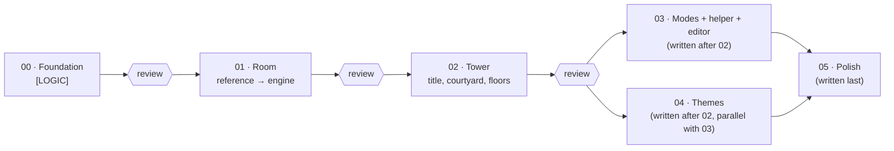

# Hening — build prompts

> **How to run:** the owner opens **Claude Code (Opus 5.5)** in `E:\Projects\retro-ports\sokoban` and says *"Read prompts/CLAUDE-CODE.md and follow it."* Claude Code runs each prompt through Gemini (`agy`, via `run-agy.ps1`), reviews the one sheet the prompt leaves, and reports. It does not repeat Gemini's QA.

## Run order

| # | Prompt | Runs | Status |
|---|---|---|---|
| 00 | `00-foundation.md` — project, importer, rules, solver, tests, review tools | **Alone**, first | Done except the solver; `00-foundation-fix-2.md` is built by Claude Code (Opus), in parallel with 01 |
| 01 | `01-room.md` — the reference scene ported onto the engine, all 50 rooms | Now, in parallel with fix-2 (checks use `arrange()`, not the solver) | Ready |
| 02 | `02-tower.md` — title, courtyard, elevator, floors, progress, results, pause, records, preferences, ending | Alone, after 01 is approved | Ready |
| 03 | `03-modes-garden.md` — Dupa mode, records per mode, Mimpi, the helper of `ARCHITECTURE.md` §9, Taman Sendiri | After 02; parallel with 04 | Ready |
| 04 | `04-themes.md` — instanced theme objects, then the four other themes (`ART-DIRECTION.md` §7.2–7.5) | After 02; parallel with 03 (file ownership in both prompts) | Ready |
| 05 | Reduced motion, phones, performance, offline build, `ART-DIRECTION.md` §15 checklist | Last | Architect writes it |

**[LOGIC] / [ART] tags:** every section is tagged. With Gemini 4 Argon, one run does both. If Argon's quota is used up, Gemini 3.8 Flash does only [LOGIC] (`run-agy.ps1 -Scope logic`) and Claude Code (Opus) builds the [ART] parts. Flash never does [ART].

**Where to review:** `review/index.html`. Every prompt leaves exactly one `sheet.jpg` and one `summary.md` in `review/prompts/<NN-name>/`; the latest frames per screen live in `review/current/`; the quality bar from the reference scene is in `review/reference/`. Nothing else keeps images (`docs/ARCHITECTURE.md` §13).

## What every prompt relies on

- `docs/ART-DIRECTION.md` + `reference/index.html` — the binding look; the reference is the quality bar.
- `docs/GAME-DESIGN.md` — what the game does.
- `docs/ARCHITECTURE.md` — how it is built.
