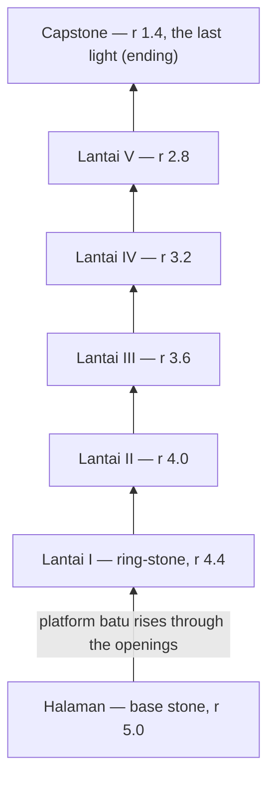

# Proposal: the tower as floating ring-stones (Batu Bertumpuk)

From Claude Code to the architect, at the owner's request (2026-11-03). Nothing here is built; it asks for a decision and, if accepted, a change to `docs/ART-DIRECTION.md` §13.2–§13.5 (and `docs/GAME-DESIGN.md` §7.2–§7.4 where noted) before any prompt touches it.

## Why

The owner, after reviewing prompt 02's frames: the tower reads as **a multi-storey car park** — square 9 × 9 terraces, bands of arches, pillars, a dome. It is built exactly to §13.2, so the problem is the spec, not the build. It is the one large shape in Hening that is not calm.

Three things in the current design already point away from a square building:

1. **Every room is a floating island in cloud.** A tower of floating stones continues that language; a square building breaks it at the one place the player returns to most.
2. **The floor screen already orbits in 36° steps for 10 rooms** (§13.5). That is a circle. On a square terrace the ten alcoves never sit evenly under that orbit; on a round stone they do.
3. **The ensō is already Hening's symbol** for *tanpa batas* (prompt 03's gate choice). Circles are the house shape.

## The proposal

**Five floating ring-stones, one per floor, stacked like a balanced cairn, with the courtyard stone at the base and a small capstone above.** The owner's idea was "stacked circles floating one above another, upward"; this keeps it and gives it a specific, quiet object: river stones balanced on each other — except that here nothing touches.

Read it bottom to top: each floor is its own stone, smaller than the one below, with open sky between them; the platform rises through one shared opening at the centre.

### Shape (starting numbers for the spec; the architect decides)

| Part | Build |
|---|---|
| **Ring-stone (each floor)** | A pebble profile turned on a lathe: flat walkable top, rounded edge, softly rounded underside. Outer radius 4.4 → 2.8 (step 0.4 per floor), thickness about 1.0 at the rim tapering to 0.6 at the inner edge. A round **opening** of radius 1.2 at the centre. Roles: `cap` on the top, `stone` on the edge and underside, same pastel three-tone shading as rooms. |
| **Spacing** | Floor pitch stays 2.4: about 1.0 of stone and 1.4 of open sky between stones. |
| **Balance** | Each stone sits 0.25–0.35 off the axis of the one below, the offset turning 36° per floor, so the stack leans and balances instead of standing like a column. The openings stay roughly aligned, so the sky behind is visible through the stack from the courtyard. |
| **Rim and alcoves** | No walls, no arches. Ten **niches** on the rim at 36°: a low curved back stone (h ≈ 0.6) behind each one, with the theme object standing in front of it and its target ring before it, exactly as alcoves work now. Between the niches, cap stones and finials like a room's wall caps. |
| **Locked / open / solved** | As §13.5: locked = the niche closed by a slab; open = object unlit, target pulsing; solved = object lit. A floor with all ten solved lights **a thin ring of light along its rim**, which from the courtyard reads as a lit ring floating in the stack (it replaces "lights its arch band"). |
| **Base stone (Halaman)** | The largest, r ≈ 5.0, its top the courtyard. The five places (§13.3) arranged around the central opening, which is where the platform waits. Below it, the plinth tiers fade into cloud as now. |
| **Capstone (top)** | A small stone, r ≈ 1.4, above Lantai V, with no opening: one niche-less light (the current theme's object, alone) where the ending happens. |

### Screens

| Screen | Change |
|---|---|
| **Title** | The whole stack in mist, a few rings lit as progress allows. |
| **Halaman** | Same places and walking; the ground is round. *Jalan Setapak* stays as stepping stones off the edge into cloud. |
| **Elevator** (§13.4) | The round **platform batu** (unchanged: r 0.8) rises alone through the openings, 3.2 s per floor. The Monument Valley architecture moves (arch bands rotating, a stair sliding out) are replaced by something calmer: the stone above slowly turns a few degrees to settle in balance as the platform passes through it. |
| **Lantai** (§13.5) | The same 36° orbit, now around a round stone: one niche faces the player at a time. Mood rule unchanged. |
| **Akhir** | The platform rises past Lantai V to the capstone; the last light comes on; the camera pulls back to the whole stack, all rims lit. |

### What does not change

Rooms, themes, modes, records, Mimpi, the helper, Taman Sendiri, the moods, the HUD, sounds, the router and every screen's flow. The theme objects in the niches come through the same `createObject()` / `createTarget()` as today's alcoves.

## Cost

Measured against the current code (about 2,500 lines across `render/tower.js` 721, `world/tower-world.js` 431, `world/tower-views.js` 86, `world/places.js` 200, and the floor, elevator, courtyard, title and ending screens):

- **[ART] — the bulk.** `render/tower.js` rewritten around lathe geometry; the elevator ride, the ending shot and the title framing re-composed. About the size of the tower half of prompt 02. It is new art the reference does not have, so by the model policy: Argon if its quota is back, otherwise Opus.
- **[LOGIC] — small to medium.** Niche positions and camera anchors per floor (the 36° orbit itself stays), the courtyard places on a round base, the mist/fog culling numbers, the elevator's path. Flash.
- **Checks.** `tools/flow.mjs` works on screens, not geometry, so it should pass unchanged. Draw calls should fall (no pillars or arch bands). Every frame in `review/current/tower/` is re-rendered and re-approved.
- **Size.** One prompt. It could be folded into 05, but it would dominate it; a separate **04b — the floating stones**, run before 05, keeps 05 a polish pass.

## Alternatives considered

| | Why not |
|---|---|
| **Plain stacked discs** (the owner's first sketch, without the cairn idea) | Works, and the proposal is this plus a reason for the sizes and the lean; plain discs of equal size read as a stack of plates. |
| **A spiral path** of stepping stones around one floating rock, rooms as stones along it | A beautiful journey, but floors stop being groups of ten, and the camera has no clean resting views. |
| **Pagoda or candi tiers** | More cultural, but still a building; it fixes the car park only partly. |

## Questions for the architect

1. **Rings or solid stones?** Rings let the platform rise through one central opening (and show sky through the stack). Solid stones would need the platform to rise outside the stack, along a path of floating steps.
2. **The niche:** a curved back stone per room (proposed), or the objects freestanding on an open rim?
3. **The lean:** a balanced offset turning 36° per floor (proposed), or a perfectly vertical stack?
4. **Where it runs:** a separate prompt 04b before 05 (proposed), or inside 05?

## Architect's decisions (2026-11-03) — accepted

The proposal is accepted. Docs updated: `ART-DIRECTION.md` §13.1–§13.5 rewritten, new §13.12 (ending); `GAME-DESIGN.md` §4.2, §7.3, §7.4, §8. Prompt: `prompts/04b-floating-stones.md`.

1. **Rings.** The platform rises along the axis through the openings; sky shows through the stack. The courtyard stone has a shallow recess instead of a hole.
2. **Curved back stone per niche**, as proposed, lower than proposed (h 0.45) and set further in (`R − 1.35`) so the object stays the hero and the back stone catches its glow. Locked = an upright slab on the object's spot.
3. **Lean, as proposed, but measured from the axis, never accumulated:** 0.22 per floor, direction turning 36° per floor, so every opening clears the platform (0.98 > 0.8) and the ride stays straight. Plus a slow breathing (±0.025, ±0.4°) so the stones feel afloat, off with reduced motion.
4. **Separate prompt 04b**, alone, after 03 and 04 are approved, before 05.

Additions beyond the proposal:

- **The figure in black moves to the capstone** and is seen from the title and courtyard as a small dark figure at the top — the player sees from the first screen where the journey ends. He is no longer in the courtyard.
- **The capstone sits beside the axis** (centre 2.3 off it), so the platform can rise next to it and the wanderer steps across. The ending keeps its beat from v1: the wanderer sits beside the stranger, who turns his head; then the pull-back to the whole stack with five lit rims.
- **Elevator settle sound:** a quiet stone knock per stone passed (bandpass 180 Hz + a 70 Hz thump).
- **The courtyard top is not tiled:** four faint raked rings instead; the walk grid stays (cells within 4.2 of the axis) and the hover tile is the room's.
