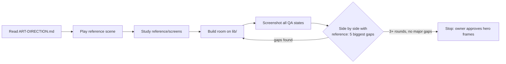
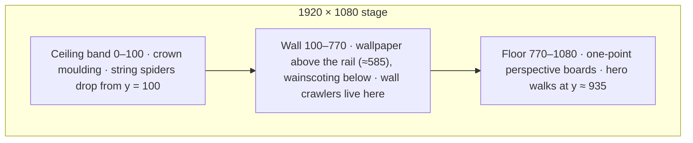
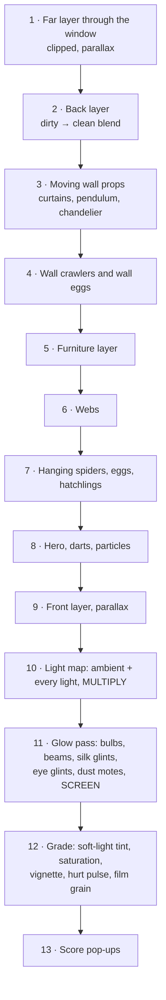

# Spyder — Art Direction

**Status:** Locked with the owner on 2026-10-26
**Applies to:** every room, character, spider, UI screen and cutscene of the Spyder web port
**Companion documents:** `DESIGN.md` (gameplay), `reference/` (the playable reference scene)

---

## 0. Read this first (for every agent)

This document exists because a previous build looked like a 1995 EGA game. The gameplay spec was fine; the visuals were described with adjectives ("modern", "god rays", "atmospheric") and the builder translated each adjective into its cheapest version. This document replaces adjectives with **numbers, rules and a working reference**.

1. **The reference scene is the quality bar, not a suggestion.** Open `reference/living-room.html` in a browser and play it before you write a line of code. Then look at the six frames in `reference/screens/`. Anything you build must look like it belongs in the same game.
2. **Build on the library, do not redraw from zero.** `reference/lib/` already contains the painterly brushes, the lighting system, the spider rig, the hero, webs, particles, audio and the diegetic HUD. A new room is mostly a new `rooms/<room>.js` plus data.
3. **Numbers in this document are minimums.** "At least 5 layers" means 5 is the floor.
4. **You are not done until the QA loop in §15 has run** and the owner has approved your hero frames.

---

## 1. Decisions locked with the owner

| Topic | Decision |
|---|---|
| Spiders | **Stylized-creepy**: exaggerated proportions, very alive legs, glinting eyes. Unsettling but pleasant to look at (think *Hollow Knight*, *Little Nightmares*). Not realistic, not cartoon-cute. |
| Overall style | **Painterly illustration**: a dark storybook. Texture, soft gradients, dramatic warm light. Never flat vector clip-art. |
| Mood | **Cozy-creepy**: warm but uneasy. Amber lamps, floating dust, the odd strange sound. No jump scares in Act 1. |
| Room makeover | **Full transformation** of 3–5 seconds when a room is cleared: webs fall, dust is swept away, lights come on one by one, colour returns, night becomes morning. This is the game's main "satisfaction" moment. |
| Player movement | **Left–right on the floor, plus climbing onto furniture** (sofa, dresser, table…) for different shooting angles. Keeps the 1983 DNA, adds depth. |
| Camera | **One screen per room with subtle parallax**: the room is a diorama, the window view and the foreground shift with the hero. |
| Hero style | **Expressive chibi**: head about one-third of the body height, readable face, clear emotions. |
| UI | **Diegetic vintage**: the interface is made of objects from the house — brass plates, paper cards, ink, stamps, string tags, gauges. |

---

## 2. The look in one paragraph

A dark storybook painting of an abandoned family house at night. Surfaces are dusty and muted; **the only saturated colours come from light** — amber lamps, cold blue moonlight, and after a room is cleaned, gold morning sun. Every shape has a slightly hand-drawn edge and visible brush texture. Light falls in pools and shafts, dust hangs in it, silk glints in it. Spiders are dark, glossy and *fast*, with legs that plant and step. The hero is a small, warm, orange figure with a face you can read from across the room. When a room is cleared it visibly comes back to life.

### Never (the failures of the previous build)

| Never | Instead |
|---|---|
| Flat single-colour rectangles for furniture | `paintShape()` with gradient, brush texture, inner shadow and rim light |
| A scene so dark the room cannot be read | Ambient never below `#584D5E`; every room has ≥ 3 lights; check the title frame too |
| Spiders as a circle with 8 straight lines | The `SpiderRig` (IK legs, planted feet, gait, eye glints) |
| A hero that is a capsule or a stick figure | The `Hero` (chibi, expressions, animation set) |
| Webs as a static image | `Web` objects that sway, tear strand by strand, and shimmer in light |
| Neon, pure black `#000`, pure white `#FFF` surfaces | The palette in §3 |
| CRT filters, scanlines, pixel upscaling | Film grain + colour grade (§6) |
| HUD as plain text in a corner | Diegetic objects (§11) |
| "Done" without screenshots | The QA loop (§15) |

---

## 3. Palette

**Rule: surfaces are muted; saturation comes only from light.** If a room needs a colour that is not here, mix it from these (`S.mixHex`), do not invent a new saturated hex.

| Role | Token | Hex | Use |
|---|---|---|---|
| Deepest shadow | `soot` | `#16120F` | Never use `#000` |
| Dark surface base | `umber` | `#2B2420` | Ceilings, deep shadow areas |
| Wood in shadow | `walnut` | `#3E3128` | Wainscoting, shelves |
| Wood in light | `oak` | `#6B5240` | Lit furniture |
| Warm grey | `taupe` | `#5A524A` | Plaster, fabric |
| Dusty cream | `linen` | `#C9B8A0` | Paper, highlights, dust |
| Brightest surface | `bone` | `#E8DCC6` | Never brighter on a surface |
| Velvet | `moss` | `#4F5A42` | Sofa, upholstery |
| Curtains | `plum` | `#4A3640` | Drapes, dark fabric |
| Leather / rug | `rust` | `#7A4A33` | Rugs, blankets, books |
| **Lamp light** | `amber` | `#F2A54A` | Lamps, candles |
| Lamp core | `ember` | `#E07A3C` | Flames, hot spots |
| **Night window** | `moon` | `#7FA3C7` | Moonlight shafts |
| **Morning light** | `dawn` | `#FFC98A` | After the makeover |
| Day sky | `sky` | `#9EC3E0` | Clean-room window |
| Spider body | `spiderBody` | `#1E1A1C` | Chitin |
| Spider sheen | `spiderSheen` | `#6E5F72` | Rim highlight on legs and abdomen |
| Spider markings | `spiderMark` | `#B9A27A` | Chevrons on the abdomen |
| Spider eye glint | `spiderEye` | `#FF6A3D` | The only bright warm spot on a spider |
| Egg sac | `eggSac` | `#D9CDB2` | |
| Goo | `goo` | `#8C8A4B` | Muted olive. **Never neon green** |
| Silk | `silk` | `#E9E4D8` | Webs, threads |
| Hero jumpsuit | `jumpsuit` / `jumpsuitShade` | `#F07F2E` / `#B4521F` | The hero is the warmest object in every frame |
| Hero gear | `gear` / `brass` | `#46505A` / `#C49A55` | |

**Moods** (`S.moods`) — the lighting system blends between them during the makeover:

| | Dirty (night) | Clean (morning) |
|---|---|---|
| Ambient (multiplied over unlit surfaces) | `#584D5E` | `#B9AA9C` |
| Shadow grade (soft-light) | `#2B2234` at 0.32 | `#FFB870` at 0.16 |
| Saturation | 0.82 | 1.0 |
| Window sky | `#141B2C` → `#2B3A55` | `#8DB6DA` → `#FFD7A8` |
| Vignette (edge alpha) | 0.62 | 0.42 |

---

## 4. Painterly technique

Everything static is painted once into offscreen canvases (twice: `dirty` and `clean`) using `S.paint`. Three tricks do most of the work; **every room must use all three**:

1. **Wobbly edges.** All shapes go through `wobblyPath()` (default wobble 1.6 px, step 18 px). No ruler-straight edges on organic objects.
2. **Never flat fills.** `paintShape(ctx, points, opts)` lays a light→shadow gradient, scatters soft brush dabs, adds an inner shadow and a rim light on the edge facing the light.
   - `strokes` ≥ 6 per 10,000 px² for any surface larger than 100×100 px (fabric 20–30, wood 10–14, plaster 9).
   - `strokeAngle` follows the material: vertical for wallpaper and wood panels, horizontal for floorboards, diagonal for draped fabric.
   - `lightDir` points toward the room's main light. Objects near the lamp use the lamp direction.
3. **Grain and grade on the final frame** (handled by the scene pipeline, §6).

Additional rules:
- Every object that stands on the floor gets a **contact shadow** (`softShadow`).
- Every object on the wall gets a **drop shadow** offset away from the main light (blur 8–14 px, painted once).
- Patterns (wallpaper damask, rug medallions, book spines) are drawn at **low contrast** (alpha 0.2–0.35) so they texture the surface without competing with gameplay.
- Bevels on wood: light line top-left, dark line bottom-right.

---

## 5. Room composition

The stage is **1920 × 1080** stage units, scaled to fit the window. All coordinates in rooms are stage units.

### Layers and parallax (minimum 5)

| # | Layer | Contents | Parallax (× hero offset from centre) |
|---|---|---|---|
| 1 | Far | View through windows/doors (sky, trees, other rooms) | −40 px at screen edge |
| 2 | Back | Wall, ceiling, floor, wall-mounted decor | 0 (collision plane) |
| 3 | Furniture | Freestanding furniture, platforms | 0 |
| 4 | Play | Webs, spiders, eggs, hero, darts, particles | 0 |
| 5 | Front | Out-of-focus silhouettes in the bottom corners (blur 7 px, painted once) | −36 px at screen edge |
| + | Air | Dust motes, god-ray beams, glow (drawn after lighting) | — |

### Content minimums per room

- ≥ **3 pieces of furniture**, of which ≥ **2 are climbable platforms** at different heights.
- ≥ **5 wall details** (frames, sconce, clock, shelf, mirror, stains…).
- ≥ **6 webs** in at least 3 different shapes (corner fan, orb, furniture-to-wall).
- ≥ **3 light sources** (§6) plus the hero's head lamp.
- ≥ **4 dirty→clean differences** in the painted layers (dead → fresh flowers, crooked → straight frame, face-down → upright photo, torn → whole shade, dull → rich fabric colour…).
- **1 story object** whose clean state reveals a fragment of the family story (Living Room: the photo on the dresser stands up; the faceless family in the portrait regains its faded child).
- **1 environmental hint** of the previous cleaner (Living Room: dusty footprints that lead to the bookshelf and stop).

### Safe zones (keep key art out from under the HUD)

| Zone | Stage area |
|---|---|
| Score plate | x 750–1170, y 0–90 |
| Work order card | x 1510–1880, y 20–300 |
| Nerve gauge | x 30–240, y 850–1080 |
| Weapon tag | x 1510–1880, y 900–1060 |
| Pause button | x 30–140, y 30–160 |

Hero frames must still be readable with the HUD visible.

---

## 6. Lighting and the frame pipeline

Light is the star. The order below is **fixed** for every room (`reference/scene.js → render()`):

### Light sources per room (minimum)

| Kind | Example in the Living Room | Required |
|---|---|---|
| A window or opening | Moon shaft + window spill (cold); becomes dawn after makeover | Yes (or a door to a lit hallway) |
| A practical lamp | Floor lamp: point + down cone + up cone + floor pool; **flickers while dirty** | Yes |
| A light that is off until the makeover | Wall sconce, chandelier bulbs | Yes, ≥ 1 |
| Hero head lamp | Cone along the aim direction, warm white, weaker in the clean state | Always (library) |
| Darts | Small moving point lights | Always (library) |

### Rules

- Light colours come from the palette light group only (`amber`, `ember`, `moon`, `dawn`).
- Every visible light source gets a **glow** in the glow pass; every window gets a **visible beam** with dust motes in it.
- Spider eyes get a glint glow whose strength follows how lit the spider is.
- **No live `ctx.filter = 'blur()'` in per-frame code.** Soft edges come from stacked shapes (see `LightMap.cone`, `shaft`, `beam`). Blur is allowed only when painting cached layers.
- The title frame (start card over the room) must still show the room: the lamp pool, the window and at least two webs must be recognisable behind the card.

---

## 7. Spiders

All spiders use **`SpiderRig`** (dorsal view: seen from above, like a spider on a wall or dangling in front of your face).

### The rig (do not simplify)

| Part | Spec |
|---|---|
| Legs | 8, each femur + tibia, 2-bone IK, **knees bulge outward** away from the body |
| Gait | Feet are planted in the world; a foot steps when > 24 × scale from its rest spot; **two alternating groups of four** (L1 R2 L3 R4 / R1 L2 R3 L4) |
| Step | 0.07–0.16 s depending on speed, eased, with a lift shadow |
| Hanging | Feet not planted; legs tuck to 82 % and paddle with noise |
| Abdomen | Exaggerated: 34 × 26 at scale 1; pale chevron markings and two "false eyes" |
| Head | 8 eyes (2 big, 2 medium, 4 small), each with an orange glint and a white catch-light |
| Life | Pedipalps always moving, abdomen breathing (±2.5 %) |
| Hit | White flash 0.2 s, goo burst (olive, never neon), legs curl in on death, body falls and splats |
| Shadow | Offset shadow on the wall; offset grows with distance from the wall |

### Types

| Type | Scale | Behaviour | Readability cue |
|---|---|---|---|
| String Spider | 1.0 | Drops on silk, brakes near its target height, hovers, drops eggs on the hero, lunges if the hero stands right below. **Silk can be snipped** for a bonus | Thin bright thread to the ceiling |
| Wall Crawler | 1.15 | Emerges from a lair (behind a frame, a crack), wanders with speed surges, **freezes** at random, lays egg sacs on the wall | Biggest, full chevrons, walks with planted feet |
| Hatchling | 0.4 | Abseils from a wall egg or hatches on the floor, zig-zags at the hero's ankles; dart or **stomp** | Tiny, no markings, very fast |
| Egg Sac | — | Falls on the hero's head (the 1983 game's signature threat) or sits and pulses faster and faster before hatching | Pale, silk-wrapped, shapes moving inside when close to hatching |

New types from `DESIGN.md` (Jumper, Egg Carrier, Web Weaver, Shadow Spider, Spider Queen) are new **brains** on the same rig, each with **one** visual difference that reads in silhouette (e.g. Jumper: thicker back legs; Shadow: no markings and eyes only visible in light; Queen: scale 2.4, pale crown pattern, slow heavy gait). Never a new hand-drawn body.

---

## 8. The hero

The **Exterminator** is implemented in `lib/hero.js`. The other three characters reuse the same skeleton, animation set and expression system; they change outfit colours, headgear and the item in hand only.

| Property | Spec |
|---|---|
| Proportions | Head ≈ ⅓ of total height; rendered at `Hero.SCALE = 1.25` (≈ 210 px tall) |
| Silhouette | Hood, goggles with head lamp, canister on the back, hose, chunky boots |
| Weapon rule | **The blaster never covers the face.** When aiming steeply up, the pivot moves forward and the head is drawn on top |
| Animation set | Idle breathing, blinking (1.8–5.3 s), run cycle tied to real speed (no skating), squash on landing, stretch on take-off, leg tuck in the air, recoil, hurt flicker |
| Eyes | Track the nearest threat (or the mouse) |

### Expressions (the face reacts before the player does)

| Expression | Trigger | Face |
|---|---|---|
| Neutral | Default | Soft smile |
| Determined | Firing | Brows down and in, flat grit |
| Surprised | A spider within 230 px of the head | Wide eyes, small pupils, raised brows, "o" mouth |
| Disgusted | Egg or goo on the head | One eye squinted, zig-zag mouth |
| Hurt | Took damage | > < eyes, open mouth |
| Relieved | Room cleared | ^ ^ closed eyes, big smile |

---

## 9. Webs

- `Web` = hub + spokes to anchors + uneven sagging rings; 12 % of rings are missing from the start.
- Optional **sheet**: the dusty film of old cobwebs, which thins as strands are torn.
- Darts tear **every strand they cross plus everything within 34 px** of the crossing — one shot visibly rips a hole. Torn ends dangle and fade over 2.2 s; fibres drift down.
- Strands sway with noise, shake when hit, and **shimmer where light falls on them** (glint pass).
- At the makeover, remaining webs **let go one after another** and drop away.
- The room's web goal is reached at **85 % of all silk torn**.

---

## 10. The makeover (signature moment)

Each beat is separate so the player can see it. Timeline used by the Living Room:

| t (s) | Beat | Sound |
|---|---|---|
| 0.0 | Work order stamped **CLEAN**, hero turns *relieved* | Stamp thud |
| 0.2 | Remaining webs release, one every 0.07 s | Soft rip |
| 0.6–2.0 | **The sweep**: a warm wave crosses the room left → right; behind it the painted layers are the clean version, in front still dirty; dust is blown off, sparkles at the leading edge, the wave carries its own light | Rising airy whoosh |
| 1.6 | The flickering lamp steadies | Chime |
| 2.0 | Sconce comes on | Chime |
| 2.3 | Chandelier swings straight (elastic) | — |
| 2.8 | Chandelier bulbs light | Chime |
| 2.6–4.2 | Curtains open, night becomes dawn, grade turns warm | Drone fades, warm chord enters, birds outside |
| 3.6 | Clock pendulum starts | Ticking |
| 4.0 | Dust motes turn into golden sparkles | — |
| 5.2 | Results card | — |

**Every room keeps the stamp, the web release, the sweep and the dawn**, and adds **one unique beat** of its own (Kitchen: the tap runs clear; Kid's Bedroom: a music box starts; Attic: the round window is unboarded, …).

---

## 11. UI (diegetic vintage)

| Element | Object | Notes |
|---|---|---|
| Score | Engraved brass plate with screws | Odometer roll-up; tabular lining numerals |
| Combo | Paper tag hanging on a string under the plate | Swings when it changes; hidden at ×1 |
| Room progress | Pinned work-order card | Hand-drawn ink line, typewriter labels, handwritten numbers, red **CLEAN** stamp |
| Health ("Nerve") | Brass pressure gauge with needle and red zone | Trembles below 35 |
| Weapon | Luggage tag | Pressure dots show the fire cooldown |
| Pause | Brass push-button, "Esc" handwritten under it | |
| Start | An old letter, deckled edge: "Clean it first. Then you will understand." | Controls in a ruled 4-column strip |
| Results | Paper card with a **RESTORED** stamp and a tally | Names the story object found |

**Fonts (bundled in `reference/fonts/`, no network needed):** Fraunces (display: titles, plate, room names), Special Elite (typewriter: labels), Caveat (handwriting: numbers on cards, notes, pop-ups).

UI motion: cards drop in with a slight rotation and overshoot; stamps slam in (scale 2.2 → 1); everything respects `prefers-reduced-motion`. Focus is always visible for keyboard users (`:focus-visible`, amber ring).

---

## 12. Audio direction

All sound is synthesised (`lib/audio.js`), so every hit varies slightly.

| Layer | Dirty | Clean |
|---|---|---|
| Ambience | Low detuned drone + wind through the frame + occasional creak | Drone fades out; warm major-seventh pad; birdsong |
| Weapon | Compressed-air pop | — |
| Spider hit | Crunchy, wet | — |
| Web | Fabric-like rip, silk "snip" when a thread is cut | — |
| Makeover | Stamp, whoosh, a chime per light, clock ticks | |

---

## 13. Performance budget

- ≤ **8 ms per frame** for update + render with GPU canvas at 1920 × 1080 (the reference measures ≈ 9 ms in headless SwiftShader, far faster on a real GPU).
- Static art is painted **once** into cached canvases (`dirty` and `clean` variants), never per frame.
- **No live blur filters per frame** (§6). Batch strokes with `Path2D` (see `Web.draw`).
- Light map at half resolution.
- Dust ≤ 200 motes; particles are culled when their life ends.

---

## 14. Code conventions

- Plain `<script>` tags and one global namespace `Spyder` (`S` inside files), so the game runs straight from disk (`file://`), no bundler.
- Folder layout: `lib/` shared systems, `rooms/` one file per room following `rooms/living-room.js`, `scene.js` orchestration.
- Humanized code: clear names, short functions, comments that explain *why*, not *what*.
- Seeded randomness (`S.createRng`) for everything visual, so rooms look identical every time and screenshots are reproducible.
- Every room exposes the same interface: `layout`, `paint(variant)`, `makeWebs()`, `createLive()`, `drawSky()`, `drawProps()`, `lights()`, `glow()`.

---

## 15. Mandatory QA loop

Append `?qa=1` to the page URL. Time freezes and `window.__spyder` can stage any state:

| State | What it shows |
|---|---|
| `title` | Start card over the living room |
| `dirty` | Room before the fight, hero idle |
| `action` | Two string spiders, a wall crawler, an egg falling, a hatchling, a dart mid-flight |
| `makeover` | 1.25 s into the makeover, sweep half-way |
| `clean` | Fully restored |
| `results` | Results card |

`reference/tools/shoot.mjs` renders all six at 1920 × 1080 with the Edge or Chrome already installed (`cd reference/tools`, `npm install` once, then `node shoot.mjs <out-folder>`). A Python version (`shoot.py`, needs `pip install playwright`) does the same. `reference/tools/flowtest.py` checks that clearing a room runs the makeover and opens the results card.

**Every room and every visual change must go through this loop:**

1. Render all states for your room.
2. Put each frame **side by side** with the matching frame in `reference/screens/`.
3. Write down the **5 biggest differences** in quality (not in content). Typical ones: flatter shading, missing rim light, darker/unreadable areas, smaller or stiffer spiders, missing glow, weaker makeover.
4. Fix them. Render again.
5. Repeat **at least 3 rounds**. Keep the notes in the room's `NOTES.md`.
6. **Stop and wait for the owner** to approve the three hero frames (`dirty`, `action`, `clean`) before building further rooms.

### Where images go (binding for every prompt and every agent)

The owner reviews everything in **one place**: `review/index.html` (open it in a browser). Images may exist in exactly three places:

| Place | What | Lifetime |
|---|---|---|
| `review/current/<room-or-screen>/<state>.jpg` | The latest hero frame of every room and screen, 1920 × 1080 JPEG (quality 90). Overwritten when a room changes. | Permanent, committed |
| `review/prompts/<NN-name>/` | Per prompt: `sheet.jpg` (the one review sheet) and `summary.md` (what changed, what to look at, check counts). | Permanent, committed |
| `.scratch/<tool-or-round>/` | Every other render: QA rounds, side-by-sides, zooms, regression diffs, flow screenshots. | Temporary, git-ignored, **emptied at the end of every prompt** |

`reference/screens/` is the frozen quality bar and stays where it is; the gallery links to it.

Use `game/tools/review.mjs` for all of it: `saveHero()`, `makeSheet()`, `scratchDir()`, `node review.mjs gallery` (rebuilds `review/index.html`) and `node review.mjs audit` (lists any image outside the allowed places — it must print nothing). No tool, room script or agent may write an image anywhere else.

---

## 16. Acceptance checklist (per room)

| # | Check | ✔ |
|---|---|---|
| 1 | Built on `lib/`; no re-implemented rig, lighting or HUD | |
| 2 | ≥ 5 layers with parallax on far and front layers | |
| 3 | All surfaces painted with `paintShape` (no flat fills), wobbly edges, contact and drop shadows | |
| 4 | Palette respected; saturation only from light | |
| 5 | ≥ 3 light sources + head lamp; flicker while dirty; glow on every source; window beam with motes | |
| 6 | Readable in the `dirty` frame: every piece of furniture and every spider can be identified | |
| 7 | ≥ 2 climbable platforms at different heights | |
| 8 | ≥ 6 webs, tearable, shimmering, released at makeover | |
| 9 | Spiders use the rig; new types differ in silhouette | |
| 10 | Hero face visible in every aim direction; expressions trigger as specified | |
| 11 | ≥ 4 dirty→clean differences, 1 story object, 1 trace of the previous cleaner | |
| 12 | Makeover keeps the shared beats and adds one unique beat | |
| 13 | HUD safe zones respected | |
| 14 | ≤ 8 ms/frame, no per-frame blur | |
| 15 | QA loop run ≥ 3 rounds, notes written, owner approved hero frames | |

---

## 17. Room bible (visual brief per room)

| # | Room | Lights (besides window/head lamp) | Platforms | Story object (clean state) | Unique makeover beat |
|---|---|---|---|---|---|
| 1 | Front Porch | Porch lantern (swinging), street lamp beyond | Steps, bench, railing | Name plate on the door polished readable | Porch light stops swinging, door opens a crack, warm light spills out |
| 2 | **Living Room** | Floor lamp, sconce, chandelier | Sofa seat, dresser | Family photo stands up; faded child returns to the portrait | Clock starts |
| 3 | Family Room | Tube TV glow (static → test card), fireplace embers | Armchair, bookshelf ledge, TV cabinet | Home-movie reel on the TV | Fireplace catches |
| 4 | Kitchen | Pendant over table, fridge light, stove pilot | Table, counter, stool | Recipe card in a known hand | Tap runs clear, kettle whistles |
| 5 | Dining Room | Candelabra, cabinet light | Long table, sideboard | Place cards: one seat that was always kept empty | Candles light down the table one by one |
| 6 | Downstairs Bathroom | Bare bulb, mirror light | Tub rim, sink | Name written in the fogged mirror | Mirror demists |
| 7 | Upstairs Hallway | Wall sconces in a row, moon through end window | Banister, radiator, side table | Height marks on a door frame | Sconces light in sequence down the corridor |
| 8 | Master Bedroom | Bedside lamps, dressing-table bulbs | Bed, wardrobe top, chest | Wedding photo | Music from a radio |
| 9 | Kid's Bedroom | Night-light projector (stars), desk lamp | Bunk bed (two levels), toy chest, desk | Drawing of the family with the hero in it | Music box plays, ceiling stars turn |
| 10 | Study / Library | Green banker's lamp, globe light | Desk, ladder, shelves | Diary pages | Globe spins, lamp turns warm |
| 11 | Upstairs Bathroom | Vanity bulbs, skylight | Bath, cabinet, laundry basket | Toothbrush cup with four brushes | Skylight unshutters |
| 12 | Attic | Hanging bulb, round window | Trunks, beams, rocking horse | The previous cleaner's lost torch | Round window is unboarded |
| 13 | Basement (secret) | Single caged bulb, boiler glow | Crates, boiler, stairs | Cellar key hook (empty) | Boiler roars to life |
| 14 | Greenhouse (secret) | Daylight through glass, grow lamp | Shelves, potting bench (vertical) | Seed packets labelled by a child | Plants unfurl |
| 15 | The Wall (boss) | Fireplace of nests, the Queen's glow | Rubble steps | The whole family portrait, complete | House-wide dawn |

Every room keeps the night → morning structure; acts escalate by palette weight (Act 1 warm, Act 2 cooler and tighter vignette, Act 3 surreal colour in the far layer).
