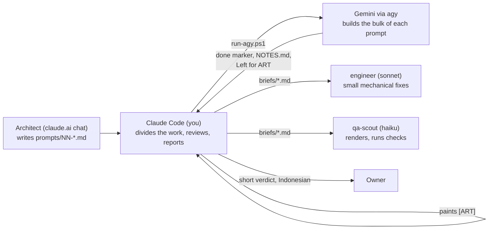

# Spyder: working in this folder

Open every session at `E:\Projects\retro-ports\spyder` (not `...\spyder\web` — that folder is an empty leftover from the repo's standard game shape; Spyder's actual port lives in `game/`). Talk to the owner in Indonesian; prompts and code stay in English.

This file is now the **single, self-contained** reference for how Spyder is built: who does the work, how a prompt runs, and the traps that have already cost a session. It used to split this across the global `~/.claude/CLAUDE.md` and `prompts/CLAUDE-CODE.md`; the crew rules ("Aturan Kru") moved out of the global file on 2026-10-30 to scope to a different project, so everything Spyder needs is inlined here instead. `prompts/CLAUDE-CODE.md` still exists as a short pointer to this file, kept for the trigger phrase "Read prompts/CLAUDE-CODE.md and follow it."

The subagents `engineer` (sonnet) and `qa-scout` (haiku) are global (`~/.claude/agents/engineer.md`, `qa-scout.md`) and available in every session regardless of this file.

## What Spyder is

A 2D house-cleaning game (DESIGN.md, ART-DIRECTION.md) built as a web port. The architect (a separate claude.ai chat) designs rooms and mechanics and writes build prompts into `prompts/NN-name.md`. Claude Code (this session) does not write game code itself — it hands each prompt to Gemini through the Antigravity CLI (`agy`), reviews the result once, paints whatever Gemini could not, and reports back.



## Who divides the work

The architect's prompts do not say who does what. **Claude Code (Opus) divides every prompt itself**, before starting anything, and writes the division into `briefs/NN-name.md` under a heading **Pembagian kerja**, with three parts:

- **Opus itself:** every visual and gameplay decision, all [ART] that Argon does not paint, the critique rounds, the review and approval of every result, and the report to the owner.
- **Delegated:** `engineer` gets mechanical [LOGIC] from a written brief. `qa-scout` gets running, rendering and checking.
- **Agy:** the prompt as a whole (Argon, `-Scope full`), or only its [LOGIC] (Flash, `-Scope logic`) when Argon is out of quota.

The brief refers to `DESIGN.md` and `ART-DIRECTION.md` rather than repeating them.

### Default split for a room prompt

| Work | Goes to |
|---|---|
| The whole prompt, Argon available | Agy (Argon, `-Scope full`), then Opus reviews |
| [LOGIC] when Argon is out of quota | Agy (Flash, `-Scope logic`) |
| [ART]: painting, light, glow, props, the look | Opus; never Flash, never a subagent |
| Small [LOGIC] fixes found in review (wiring state the art needs, QA states, guards in `game/lib/`) | `engineer`, with a brief that names the files and the expected behaviour |
| Hero shots (`shoot.mjs`), `regress`, `checks`, `flowtest`, `perf`, `audit`, console errors, headless play-throughs, reading Agy's log and its "Left for ART" | `qa-scout`, reporting the exact output |
| Judging the renders, the critique rounds, the verdict | Opus |

This is the default. When a prompt calls for something else, the brief says so and gives the reason.

### Deciding, in this order

1. Is it [ART], or a visual or gameplay decision? Then it goes to Opus (or to Argon, if Argon is painting the whole prompt).
2. Is it a whole prompt, or a whole [LOGIC] section with a full specification that can run on its own? Then it goes to **Agy**. Every room prompt from the architect starts here.
3. Is it running, rendering, checking or reading, with no decision in it? Then it goes to `qa-scout`.
4. What is left is small, mechanical code work that turned up during review, or the glue between Agy's logic and Opus's art. That goes to `engineer`.

**`engineer` never takes a whole prompt or a whole [LOGIC] section while Agy can run it.** It does so only when Argon and Flash have both failed (`quota=1` or an error in the `.done` file). The brief and the report then say so.

**Visual and gameplay decisions are never delegated**, to `engineer`, `qa-scout`, or Flash. `engineer`'s own role file refuses them too (it is told to stop and report the question instead).

## The crew (from 2026-10-30)

DeepSeek joined via OpenCode (`prompts/run-opencode.ps1`). The full roster and what each one is for:

| Crew member | How it is called | Use it for | Never |
|---|---|---|---|
| **Opus 5.5** (you) | — | Dividing the work, every visual/gameplay decision, [ART] when Argon is out, the one review, the report | Mechanical work another member can do |
| **Sonnet** | `engineer` subagent | Small [LOGIC] fixes and glue found in review, from a brief | Whole prompts while an external runner can take them; any visual decision |
| **Haiku** | `qa-scout` subagent | Running tools, renders, reading logs and "Left for ART", reporting exact output | Decisions, code |
| **Agy Argon** (`gemini-4-argon-high`) | `run-agy.ps1 -Scope full` | A whole prompt, [LOGIC] + [ART] in one run | — |
| **DeepSeek v4 Pro** (`deepseek/deepseek-v4-pro`) | `run-opencode.ps1 -Scope logic` | A prompt's whole [LOGIC] when Argon is out — **first choice** for the logic run (trial from prompt 17; see below) | Painting |
| **Agy Flash** (`gemini-3.8-flash-high`) | `run-agy.ps1 -Scope logic` | [LOGIC] fallback when DeepSeek Pro fails or is out of quota | Painting |
| **DeepSeek v4.1 Flash** (`opencode/deepseek-v4.1-flash-free`, free) | `run-opencode.ps1 -Model opencode/deepseek-v4.1-flash-free -Brief <file>` | Cheap mechanical briefs with a full spec: data tables, a new check in `checks.mjs`, doc updates, NOTES.md, wiring QA hooks | Painting, anything needing judgement, shared `game/lib/` core changes |

**Order of fallback for a prompt's [LOGIC]:** Argon full → DeepSeek v4 Pro logic → Agy Flash logic → `engineer` (only when all three fail; say so).
**[ART] is only ever Argon or Opus.** Neither Flash nor either DeepSeek paints — not even a "small" prop.

### The DeepSeek v4 Pro trial

Prompt 17 is the first [LOGIC] run on DeepSeek v4 Pro. Review its logic exactly as you would Flash's (checks, regression, does the "Left for ART" list make sense, are blockouts marked `// ART: blockout`). Write one line in the summary: **"DeepSeek Pro vs Flash: better / same / worse — why"**. If it is worse twice, swap the order (Flash first) and note it in this file.

### run-opencode.ps1

```powershell
Start-Process powershell -WindowStyle Hidden -ArgumentList '-NoProfile','-ExecutionPolicy','Bypass','-File','E:\Projects\retro-ports\spyder\prompts\run-opencode.ps1','-Prompt','<NN-name>'
# options: -Model opencode/deepseek-v4.1-flash-free   -Scope logic|full (default logic)   -Brief briefs\<file>.md (instead of -Prompt)   -NoteFile <path>
```

It writes `prompts/logs/<name>.dspro.log` (or `.dsflash.log`) and a `.done` marker in the same `exit= quota= scope= model= minutes=` format as `run-agy.ps1`, so the same single background wait works. `-Scope full` exists but is not used: DeepSeek does not paint.

### Running two runners at once

Agy and OpenCode are different accounts, so a DeepSeek logic run and an Agy run can go in parallel when two prompts do not touch the same files (the prompt says when that is allowed). Free DeepSeek Flash briefs can run alongside anything that does not touch their files.

## Model policy (decided by the owner, 2026-10-29; extended 2026-10-30 with DeepSeek, see "The crew")

Every prompt marks its sections **[LOGIC]** (data, layout numbers, gameplay, spawns, rules, QA hooks, tests, tools) or **[ART]** (painting, lighting, glow, props, the look).

| Situation | [LOGIC] | [ART] |
|---|---|---|
| Gemini 4 Argon available | Argon (`-Scope full`) | Argon, same run |
| Argon quota used up | DeepSeek v4 Pro: `run-opencode.ps1 -Scope logic`; if that fails, Gemini 3.8 Flash: `run-agy.ps1 -Model gemini-3.8-flash-high -Scope logic` | **Opus** paints it, after the logic run |

- **Never let Flash paint.** Its painting was rejected early on and had to be redone — the double cost the owner wants to avoid.
- A quota failure shows as `quota=1` in the `.done` file (usually after a few seconds). Switch to the Flash `logic` run; do not retry Argon in a loop. Try Argon again only at the next prompt.
- After a Flash `logic` run: read its `summary.md` section "Left for ART", paint every [ART] item in the files the prompt names (keep the [LOGIC] code as it is), run only the checks the prompt lists, then make the sheet and finish the summary with `review.mjs`. Note in the summary which parts Flash built and which Opus painted.
- Painting yourself is the expensive path: do it once, aimed at the reference, without extra critique rounds beyond what the prompt asks.

## How to run a prompt

1. Check the repo first: is `prompts/logs/<NN-name>.done` already there, or is an `agy` process running (`Get-CimInstance Win32_Process -Filter "Name='agy.exe'" | Where-Object { $_.CommandLine -match 'retro-ports\\spyder' }`)? Never start a prompt that is already running or done.
2. Start it detached:
   ```powershell
   Start-Process powershell -WindowStyle Hidden -ArgumentList '-NoProfile','-ExecutionPolicy','Bypass','-File','E:\Projects\retro-ports\spyder\prompts\run-agy.ps1','-Prompt','<NN-name>'
   ```
   It runs `agy -p` with `gemini-4-argon-high` by default (pass `-Model` to change, `-Scope logic` for a Flash logic-only run, `-NoteFile <path>` to append a short note to the task — e.g. what else is running in parallel and which files to stay out of). It writes `prompts/logs/<NN-name>.log` (or `<NN-name>.logic.log` for a logic run) and, at the end, `prompts/logs/<NN-name>.done` (`exit=… quota=0|1 scope=… model=… minutes=…`). This account does not support `--mode auto`; the script uses the default mode with auto-approved permissions, and that warning in the log is harmless.
3. Wait **once**, in the background (a single background command with a long timeout), rather than polling in a loop.
4. On `quota=1`: rename the log/done files to `*.argon-quota.*` (or `*.dspro-quota.*`, `*.flash-quota.*`), start the next [LOGIC] runner in the fallback order (DeepSeek v4 Pro, then Agy Flash), and wait again.
5. When done: read the `.done` file, `review/prompts/<NN-name>/summary.md`, and (if Agy made one) the sheet.
6. Review against `ART-DIRECTION.md` and `reference/screens/`. Judge: does each frame look like the same game as the reference? Is every fix in the prompt visible on the sheet?
7. Append the verdict to `summary.md` (`**Claude Code review:** approved` or `fix needed — …`) and rebuild the gallery (`node game/tools/review.mjs gallery`). Report to the owner in Indonesian, short: what got done, what parts went to Agy/engineer/qa-scout, your verdict, and that the gallery is at `review/index.html`.
8. If a fix is needed: write a short follow-up (either a `prompts/NN-name-fix-1.md` for Agy, or a `briefs/` for `engineer`), run it the same way, review once more. At most two follow-ups per prompt before reporting the remainder to the owner.

### Two prompts in parallel

When the queue allows two prompts to run together, start both with `run-agy.ps1` (two `Start-Process` calls), then wait once for **both** done markers. If one prompt's Agy run depends on another finishing first (e.g. both touch `game/lib/`), chain it: wait for the first `.done`, then start the second — see `briefs/13-study.md` for a worked example (it started automatically once `12-weapons-rest`'s logic run finished, via a background shell script).

## Keeping token use low (the owner pays for every model)

- **Never poll in a loop.** Start the build detached, then run one background wait that ends when the done marker appears.
- **Read only what a prompt's deliverable names**: the done marker, `review/prompts/<NN-name>/summary.md`, and a sheet if Agy made one. Delegate wider reading (logs, "Left for ART", file diffs) to `qa-scout`.
- **Images:** never write them anywhere but `review/` (via `review.mjs`) or `.scratch/`/the session scratchpad; empty `.scratch/` at the end of every prompt (ART-DIRECTION §15, "Where images go").
- **One review, not a QA loop.** At most two follow-ups per prompt.
- Delegate re-running regression/flow/perf/screenshot tools to `qa-scout` rather than doing it inline yourself.

## Traps

- **Run the browser test suites one at a time.** `flowtest.mjs` failed once on the Dining Room's real-time spawn check while two other headless jobs ran alongside it. Run alone, it passed.
- **Do not pass a positional argument to `regress.mjs`.** `node regress.mjs living-room` treats it as the output folder and writes `*-compare.png` into `game/tools/living-room/`, outside `.scratch/`.
- **An author `display:` beats the `hidden` attribute.** Any element that script shows and hides with `hidden` needs a `[hidden] { display: none }` rule if its class also sets `display`. `.tag__dots` and `.card__unlock` both shipped visible because of this.
- **Never use a negative `z-index` on HUD pieces.** It puts them behind the game canvas.
- **Never let two jobs write the same room's `art.js`.** While Agy is running, Opus paints in the scratchpad and installs the file only after the `.done` file appears.
- **A hand-placed QA critter that starts too close to the hero can bite it during the staging step**, leaving `hero.invulnerable` high enough to trigger the runtime's red "hurt pulse" over the whole frame. Give it the same stand-off distance the type's own default spawn uses (seen in the Study and the Upstairs Bathroom, both ~400+ px).
- **Headless shots of the HUD catch it invisible.** `#hud` fades in with a CSS transition, and headless Chrome advances transitions only when a frame is captured, so the first screenshot shows opacity 0. Add `#hud { transition: none !important; }` with `page.addStyleTag` and take a 10×10 warm-up shot first. Timed HUD pieces (the 2 s boss phase note) can expire inside one screenshot when the machine is loaded; trigger them through the real path and hold their hide timer for the shot (see `review/prompts/15-boss-system/summary.md`).
- **Check the machine is idle before trusting `flowtest`'s real-time checks.** Other projects run heavy jobs here (e.g. a 24-thread `solve.mjs`); under that load "runs in real time and spiders come" fails with one critter at 2.5 s.
- **`paintShape`'s inner shadow and rim are blur filters, and the GPU pays for them on the room's first frames, not when you paint.** On huge shapes (rafters ~1500 px long, full-height boards) that stall ran past `flowtest`'s settle time and failed "runs in real time" in the Attic three times. Use `innerShadow: 0, rim: 0` on large flat shapes and draw the lit/shadowed edge as a line.
- **Do not measure frame cost with a synchronous loop of `step()` calls.** Without yielding, the GPU queue fills and you get 1–2 s "frames" in any heavy room (the approved Kitchen too). Await `requestAnimationFrame` between frames, as `perf.mjs` does.
- **A `hover: true` string spider needs its feet replanted** (`rig.plantAll()`) after its `y` is force-set, or its legs render stretched to the ceiling in any QA state that doesn't step a frame afterward. Fixed at the source in `lib/spider-types/string.js`.

## Rules that never change

- `reference/` is the quality bar. It is changed only where a prompt explicitly says so.
- Nothing is committed or pushed unless the owner asks. When asked: list what will be committed, exclude `.scratch/`, `node_modules/`, logs and anything a running `agy` session is still writing, then commit with a descriptive message.
- Check the repo state before every action; sessions may have run without you knowing.

## Reporting

The report to the owner is in Indonesian. For each prompt it says which parts Opus did itself, which went to `engineer` or `qa-scout`, and which went to Agy (and which model). The summary in `review/prompts/<NN-name>/summary.md` records the same thing, and the brief in `briefs/NN-name.md` keeps a running "Run log" of what was tried and when.

## Right now

Prompts 00–16 are done and approved (`review/index.html` has every sheet). 16 left two phase-note lines in A.'s voice for the architect to approve (listed in its summary). The queue:

| Order | Prompt | How |
|---|---|---|
| 1 | `prompts/17-lore-scrapbook.md` + `prompts/18-cutscenes.md` | **In parallel**, after 16 is approved. Story layer from `STORY.md`. Suggested: 17's [LOGIC] on DeepSeek v4 Pro (the trial), 18 on Argon full if available (else its [LOGIC] on Agy Flash). Opus paints whatever [ART] is left — 18's sixteen panels are the big item; paint them once, aimed at `STORY.md`'s panel notes. |

`STORY.md` is the story bible: every text in the game comes from it. If a prompt needs a line it does not have, write it in A.'s voice and list it in the summary for the architect.

After 18 the next prompts come from the architect. Do not invent new rooms or mechanics while waiting.
