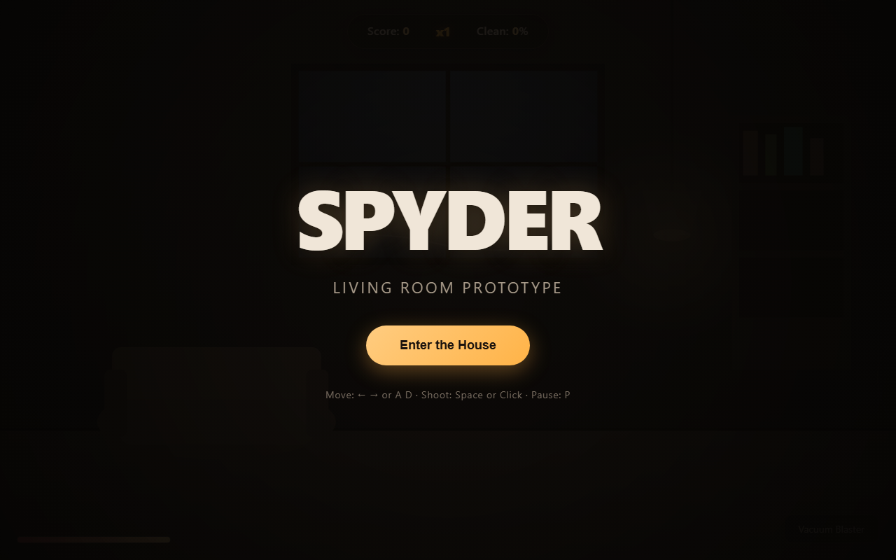

# Spyder — Web Port Prototype

Prototype of the Living Room level for the modern web reimagining of *Spyder*.

## Run locally

```bash
cd E:/Projects/retro-ports/spyder/web
python -m http.server 8080
```

Then open `http://localhost:8080/` in a browser.



## What's implemented

- SVG background: living room with sofa, window, lamp, bookshelf, worn walls.
- Canvas game layer with player character (The Exterminator).
- Movement: arrow keys or A/D.
- Shooting: Space or click/tap.
- Two spider types:
  - **String Spider** — descends on a thread, sways, climbs back up.
  - **Wall Crawler** — moves along walls and ceiling.
- Scoring, combo multiplier (up to x5), room clean progress.
- Health bar, particle effects, swaying webs, floating dust.
- Start / pause / game over overlay.

## What's NOT in this prototype

- Multiple characters (only The Exterminator).
- Multiple weapons (only Vacuum Blaster).
- Egg sacs, power-ups, room makeover, story collectibles.
- Multiple rooms (only Living Room).
- Audio.

These are planned in `../DESIGN.md`.

## Controls

- Move: `←` `→` or `A` `D`
- Shoot: `Space` or click/tap
- Pause: `P`
