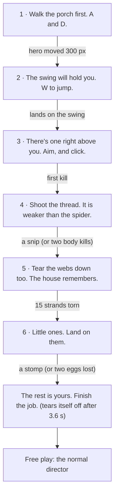

# Room 1: the Front Porch — notes

*Prompt 01 (`prompts/01-front-porch.md`), built 2026-10-28. Stopped at the hero-frame checkpoint, waiting for the owner's review. No other room was started.*

The porch is the first thing a new player sees: the front of the house at night, seen from the yard, with the door shut and one lantern swinging. It is also the tutorial. Six handwritten notes from "A." are pinned to the left post one at a time, and each is torn off when its job is done.

## Files

| Path | What it is |
|---|---|
| `room.js` | The room: layout, painting, webs, far layer, live props, light rig, makeover beats, the tutorial, QA staging. Same shape as `rooms/living-room/room.js`. |
| `../../tools/rooms/front-porch-playtest.mjs` | Plays the room start to finish through the real page (real keys, mouse and time), then checks Tab skip. `cd game/tools && node rooms/front-porch-playtest.mjs` |
| `../../tools/rooms/front-porch-perf.mjs` | Frame time, measured the same way as `tools/perf.mjs` (which only measures the Living Room). `cd game/tools && node rooms/front-porch-perf.mjs` |
| `../../../review/current/front-porch/` | The six hero frames, 1920 × 1080 JPEG: `dirty.jpg`, `tutorial.jpg`, `action.jpg`, `makeover.jpg`, `clean.jpg`, `results.jpg`. |

The only shared edit is one line in `game/index.html`, in the "Rooms, one line each" block, before the Living Room:

```html
<script src="rooms/front-porch/room.js"></script>
```

## Regenerate

```
cd game/tools
node shoot.mjs --hero --room=front-porch       # hero frames into review/current/front-porch/

node rooms/front-porch-playtest.mjs      # 28 checks, all pass
node rooms/front-porch-perf.mjs          # ≈ 2.1–2.4 ms mean per frame
```

QA states: `?qa=1&room=front-porch`, then `setup('dirty' | 'tutorial' | 'action' | 'makeover' | 'clean' | 'results')`. `tutorial` stages note 3 on the post, a tamed spider hovering above the swing, and the hero on the swing aiming up at it. `S.rooms.get('front-porch').qa.peek()` is a read-only view (tutorial step, hero, swing, scripted spider) for play tests.

## The room, as built

| Element | Where (stage units) | Notes |
|---|---|---|
| Porch ceiling | x 136–1784, y 0–124 | Beadboard, painted haint blue (grey-blue dirty, pale blue clean). The boards crowd together toward the house, so the band reads as a ceiling going away from us. Gutter and beam at the top, a deep shadow line where it meets the house. `CEILING = 120`. |
| Facade | x 150–1770, y 120–770 | Clapboard, 34 px boards, each with a lit lower edge and a shadow lip under it. `taupe` + `moon` (`#64696D`). Dirty: 14 peeling patches showing bare grey wood, stains, mildew, a grey film. |
| Front door | x 870–1050, y 332–770 | A live sprite, so it can open. Dirty: grey paint flaking off, and under the flakes the old moss green it used to be. Clean: deep moss green, brass shining. |
| Transom | x 870–1050, y 256–302 | A fan of amber/plum/moss segments round a half sun, in lead came. |
| Name plate | centre (960, 317), 128 × 32 | The story object. Tarnished with verdigris, "ASHWORTH" barely there (dirty); polished and readable (clean). |
| Windows | x 380–620 and 1280–1520, y 270–560 | Six-pane sashes with shutters. A dark room inside each (a table lamp, a chair and a frame). The right window's left shutter hangs askew from its top hinge while dirty, and the bottom hinge plate is still on the wall. |
| Posts | x 150–200, 1720–1770 | Turned, drawn from a woodturner's profile. Rim light toward the lantern, moon on the far edge of the left post. |
| Porch floor | y 770–1000 | One-point perspective, like the reference. Per-board tone, butt joints, the lantern's pool, a lit nosing at the front edge. Dead leaves (dirty). |
| Steps | y 1016–1080 | Front layer, two treads with lit nosings. |
| Far layer | x 0–150, x 1770–1920 | Night sky, stars, moon (upper left), bare trees, hedge and fence. A neighbour's roofline with one lit window, a second roof, a town glow, and a street lamp on the far right. Turns to dawn with the shared beat. |
| Wall details | | Mailbox with "17" and uncollected letters, doorbell, threshold, hanging fern basket, transom, plate. |
| Front layer | bottom corners | Blurred bramble bush (dirty) or leafy shrub (clean) bottom left; the steps' newel post and a shrub bottom right. Dirty: thick cobweb strands across the top corners. |

**Platforms:** floor (y 935), the porch swing (seat y 800, platform x 320–600), the planter box (x 1304–1456, y 820) and the side railing (x 1560–1840, y 760). The floor-to-railing jump is 175 px; a full jump is 208 px.

**Lights:** the lantern (point, down cone, up cone, a floor pool that slides with the swing, frame shadows); the moon (broad spill from (−200, −200) at 0.55, a fill past the left post, and a visible beam slanting across the left porch); the street lamp (0.2 at the right edge, out at dawn); the open sky by the right post. Off until the makeover: the transom, the door wedge, the two windows. Plus the shared head lamp and darts.

**Webs (8):** corner fans top left and top right, an orb between the left post and the facade, a big web across the upper half of the right window, the lantern chain to the ceiling, the swing's right chain to the ceiling, the planter corner, and the top corner of the door casing.

**Dirty → clean:** plate tarnished → ASHWORTH; shutter askew → straight; door flaking grey → moss green, brass shining; fern dead → full; mat letters under dust and leaves → WELCOME; geraniums dead → muted coral blooms. Also: swing cushion mildewed → striped; lantern glass sooty → clear; peeling paint, stains and leaves gone.

**Trace of the previous cleaner:** yellow rubber gloves and an old pump sprayer. Dirty, they lie dusty by the door under the lantern: one glove draped over the tank, one on the boards, the wand pointing at the door. Clean, they stand neatly against the wall by the planter, gloves folded on top.

## How the moving parts work

**The swing.** `onUpdate()` moves the swing platform's `x0`/`x1`, and the runtime carries a hero standing on it. Landing on the seat (`land` event) kicks a damped sway: 9.6 px × e^(−t/1.9) × sin(2πt/1.6), so the first swing peaks at about 8 px and the period is 1.6 s. A breeze of ±1.2 px keeps it from ever being perfectly still. The play test measured a 7.4 px range in the 0.8 s after landing, and the platform moved with the hero on it.

**The lantern.** It swings ±0.08 rad over a 3.4 s period, plus a little noise, and flickers through `S.light.flicker` while dirty. `lanternPose()` gives its angle, glass centre and "down" direction. The light point, both cones and the floor pool all use it, so the light swings with the lantern. The frame's shadows are drawn into the light map: each corner post throws a thin wedge radiating from the flame, painted back toward the ambient colour over the light already added, so the shadows sweep with the swing. Only the cage casts them; the hero and the spiders do not.

**The unique makeover beat.** At 3.4 s the lantern stops swinging (0.5 s). At 3.9 s the door turns on its left hinges, its width shrinking by 20%, over 0.8 s, with a creak; the warm hall shows in the gap and a wedge of light sweeps out across the boards. The windows light at 4.6 s and 4.9 s, 0.3 s apart, each with a chime (A, C♯, E, A over the four lights). The shared beats are the runtime's: stamp, web release, sweep, dawn, sparkle, results at 5.2 s. The flicker stops at 1.6 s and the transom glows at 2.0 s, in the slot where the Living Room's sconce comes on.


Read it left to right as one timeline. Everything from 3.4 s on is the porch's own; the rest is shared with every room.

## The tutorial

The notes are DOM, not canvas. Caveat text stays crisp, an `aria-live` region reads each note to screen readers, and the tear-off is a CSS animation. They sit under the HUD and the cards, so the pause card and the fade cover them. The paper is shaded cool on the moon side and warm on the lantern side. Since it is DOM, the scene's light map and grade do not touch it.

While the tutorial runs, `direct()` returns true and the room spawns its own critters. The teaching spiders are tame: no lunge, no eggs, no climbing away.



Each arrow is what tears the note above it. Between notes there is a 0.7 s gap. Tab skips the notes from anywhere: the current note tears, and the director takes over. A porch already cleared in `S.progress` starts with no notes at all.

Scripted setups: note 3 drops a tame String Spider above the swing (x 490, y 430). Note 4 hangs a second one high (x 690, y 300). Note 6 drops an egg on open boards beside the hero (never on the swing or the planter) that hatches after 1.3 s. Of the three hatchlings the runtime makes, one is removed and the other two move at 60% speed.

## Decisions (where the prompt left room, or where I moved something)

- **Transom, plate and door top.** The prompt puts the transom at y 270–325, the plate at y 300 "under the transom", and the door from y 330, which overlap. Built: transom 256–302, a head rail 302–332 carrying the plate, door 332–770.
- **The plate is 128 × 32, not 70 wide.** At 70 px, "ASHWORTH" could not be made readable, and readable is the point of the story object.
- **The swing platform is inset 20 px each side** (x 320–600, seat drawn x 300–620), like the Living Room's sofa. **The hero's left bound is 232.** Both keep the hero from standing under the note on the left post.
- **The note sits at x 82–272, y 506–740:** eye level for the hero on the swing (his eyes are at about y 633). On the floor his eyes are at about y 768, just below it. Lower, it would cover him on the floor.
- **A seventh note, not in the prompt:** "The rest is yours. Finish the job." It tears itself off after 3.6 s, so the end of the tutorial is visible. Remove the `finish()` call's note if it is not wanted.
- **Two soft exits.** If note 4's spider is shot twice instead of snipped, or note 6's hatchlings are lost twice, the tutorial moves on. The prompt says "done when a silk snipped" and "a hatchling stomped"; without these exits a player who never manages either is stuck behind a note until they find Tab.
- **The trace moves between variants, so it is drawn live.** In the furniture layer, the crossfade would show both copies mid-sweep. It was there in round 1; see below. Two small sprites now hand it over as the wave passes. Dirty, it is "by the door" on the door's right, under the lantern, because the hero's start position covered the left side.
- **Haint-blue ceiling, and old green under the door's grey.** Neither is in the prompt. The first is the traditional porch-ceiling colour; the second foreshadows the clean door.
- **"17" on the mailbox** is invented.
- **The planter blooms and the clean fern show through ahead of the sweep**, exactly as the reference's dresser flowers do. The runtime's crossfade draws the clean layer under the dirty one. Accepted, not fixed.

## QA record

Every round rendered dirty, tutorial, action, makeover, clean and results, and put dirty, action, makeover and clean side by side with `reference/screens/`. The composites were temporary QA renders in scratch folders (now cleaned up).

### Round 1

1. **The porch floor read as a flat dark band.** The lantern's pool was small, the boards barely visible. → A lighter floor tone, a different tone per board, the floor pool from radius 320/0.45 to 470/0.62, the down cone from 860 to 1000 long.
2. **The lantern-frame shadows were hard dark bars crossing in an X over the door.** → Strength 0.5 → 0.32, three nested wedges with soft edges, starting 60 px from the flame instead of 44.
3. **Peeling paint and door flakes looked pasted on**, like stickers and camouflage spots. → Patches at 0.3 alpha (was 0.5) and 80% size, quieter edges; 24 smaller door flakes, mixed toward the door colour.
4. **The swing and the right post sank into the wall, and the corner boards read as a second pair of posts.** → The swing in lighter weathered wood with a moon rim, plus a shadow on the siding behind it; a sky fill beside the right post; corner boards removed.
5. **The moonbeam started as a bright bar under the pause button, and the right far region was nearly empty.** → The beam now enters at the left post (y 196–250); a stronger sky light on the right, and a pool of street-lamp light on the hedge.

Also fixed: the fern covered the name plate (moved to x 750, narrower when alive); the hero stood in the doorway in the makeover and clean frames (QA x 1010 → 720); the lit windows were flat yellow (a gradient, a shaded head, lace catching the lamp); the sprayer appeared twice mid-sweep (now live sprites); the action frame's egg was hidden behind the hatchling (moved to x 1240).

### Round 2

1. **The hero, at his start position, covered the previous cleaner's sprayer and gloves.** → Moved by the door, under the lantern; clean, by the planter.
2. **The dirty windows were black holes**, where the reference's glass reads as glass. → A cool moonlit sheen and a brighter reflection streak on the panes.
3. **The steps were a featureless black band.** → Lighter treads with a moon/dawn rim.
4. **The far right still read as empty black**; the neighbour's house did not separate from the sky. → A faint town glow behind it, a lighter silhouette, a second roof further off.
5. **The engraving ran to the edges of the plate.** → 16 px with 1.5 px letter spacing (was 17/2).

Also: the lantern bloom 200 → 250, so it reads as the key light like the reference's lamp.

### Round 3

1. **The clean frame was washed out**: pale grey siding and floor, little contrast, where the reference's morning is warm and deep. → Clean siding mixed toward `oak` instead of `linen`; clean boards in warm oak.
2. **Morning light flooded the clean facade evenly**, with no direction. → The upper-left dawn spill 0.85 → 0.72.
3. **The planter and its dead geraniums read as a dark crate** in the dirty frame. → Weathered grey wood with a lantern rim, paler dead stalks and heads.
4. **The lit windows were one flat orange.** → The dark room shows through a little (0.92 → 0.82).
5. **The steps were still lost.** → A lit nosing line on each tread.

### Round 4

1. **The lantern's warm reach was narrower than the reference lamp's.** → Point radius 660 → 720.
2. **The beadboard barely caught the lantern's up-light.** → Up cone 380/0.35 → 460/0.5.
3. **In the clean frame the lit windows competed with the hero as the warmest spot** (ART-DIRECTION §2: the hero is the warmest object). → Window fill 0.72, light 0.45, glow 0.26.
4. **The steps still sit under the vignette.** → Accepted: the reference's bottom edge is just as dark, and play happens above it.
5. **The paper note is the brightest flat object in the dirty frame** (DOM, unlit). → Accepted: the HUD's cards do the same, and the note has to be readable at a glance.

### Round 5 (confirmation)

No new major gaps; these are the hero frames. Differences from the reference that I judged and kept:
- The clean frame is cooler than the Living Room, because the siding is painted blue-grey. That is the material, not the light.
- The dirty facade is lit more evenly than the reference room. It is an exterior, with the moon spilling across it.
- The lantern stays on in the clean frame, as the reference's floor lamp does.

### Play test (`playtest.mjs`): 28 checks, all pass on three runs of the final version

Played with real keys, mouse and time in headless Edge: New game opens the map with the porch focused. In the porch, note 1 is alone on the post. Walking 300 px tears it. A jump lands on the swing, which sways 7.4 px and carries the hero. A shot kills the first spider. Stepping off to the side and shooting high snips the second one's thread (`ended by: cut`). 15 strands are torn on the webs. Then the egg hatches two hatchlings and a hop stomps one. The last note appears and tears itself off, and the director sends spiders. `clearRoom()` starts the makeover, the results card names Ashworth, and Next room points to the Living Room. Room map shows the porch cleared. Entering it again, there are no notes and the director runs at once. With a fresh save, Tab tears note 1, ends the tutorial, keeps the focus on the canvas, and the director starts. No console errors.

Getting the test to play correctly found three things, all in the test's own moves rather than the room. Each is worth knowing for a player too:
- A hop under the swing lands you back on the seat, so the hatchling note has to be done out from under it.
- Aimed from straight below, a dart meets the body before the thread. A snip works from the side, at the top of the thread.
- The respawned note-4 spider descends through the aim point, so firing while it descends kills the body. Wait for it to hang still.

### Performance (`perf.mjs`, headless Edge, ANGLE on Intel UHD, the same method as `tools/perf.mjs`)

| State playing live | Frames in 4 s | Mean | Median | 95th pct |
|---|---|---|---|---|
| porch, action | 237 | 2.41 ms | 2.20 | 3.60 |
| porch, tutorial | 255 | 2.12 ms | 2.00 | 3.20 |
| porch, makeover | 387 | 1.36 ms | 1.10 | 2.20 |
| Living Room, action (same run) | 328 | 2.03 ms | 1.90 | 2.90 |

Budget 8 ms. Every `ctx.filter` blur in `room.js` is in paint-once code: the layers, and the door, swing and trace sprites, which are painted once and cached.

### Shared tests after adding the room

- **`regress.mjs`: passes.** The Living Room canvas matches the reference in every state (3–8 px at 1 level, the browser's own noise). The `results` *screen* differs by 558,845 px, all inside the card. Because an uncleared Front Porch now comes first in house order, the Living Room's results card offers "Next room →" instead of the pencil note about the Family Room, and the card is taller.
- **`flowtest.mjs`: fails, as expected, from the new unlock order.** The first failure is "the next room has the focus (front-porch)". Clicking the Living Room then does nothing, because it is locked, and every later check cascades from that. The script then stops on an uncaught click timeout, so its storage-blocked half never runs. I did not edit it. An adapted copy (porch instead of Living Room, Tab to skip the notes, Ashworth and "Next room: living-room" as the expected texts; kept in my session scratchpad, not in the repo) passes all 37 checks, with storage available and blocked.
- **`checks.mjs`: 21 pass, 3 fail, all from the same assumption.** It registers the Kitchen and the Front Porch as stand-ins "for rooms that are not built yet" and expects the map to start on the Living Room. One thing for the shell's owner to look at: from the porch, ArrowRight moves the map focus to the Attic.

## Requests for the runtime (worked around inside the room)

1. **Room-scripted spawns all get the same seed.** `spawn()` seeds from `director.spawned`, which only the director advances, so every tutorial spider has the same rig. Ask: accept `opts.seed`, or count every spawn.
2. **`world.hatch()` always makes three hatchlings at full speed.** The tutorial wants two, slower; it removes one in the `hatch` listener and slows the rest. Ask: `hatch(egg, { count, speed })`.
3. **Egg hatch time is set by writing `egg.hatchAt`.** It works but is not part of the contract. Ask: `spawnEgg(x, y, mode, { hatchAt })`.
4. **No supported way to place the hero on a platform in QA staging.** The `tutorial` state writes `hero.y`, `onGround` and `standingOn` directly. Ask: `api.placeHero(x, platform)`.
5. **`glow()` does not get the far layer's parallax offset**, so glows on far objects (moon, street lamp) are offset by recomputing `camX` from `world.hero`. Ask: pass `camX` to `drawSky`/`glow`, or put it on `world`.
6. **The furniture crossfade shows both copies of anything that moves between variants.** Worked around with live sprites. Ask: document it in the room interface, or a helper for "an object that moves at the makeover".
7. **A room has no sanctioned place for its CSS.** The tutorial injects a `<style>` element inside its own container, which `onLeave()` removes. Ask: a hook for a room stylesheet.
8. **`flowtest.mjs` and `checks.mjs` assume the Living Room is the first built room.** They need updating now that the porch exists (and the Kitchen).

## Not verified, or open

- **Not play-tested by a person.** Every check is automated. The feel of the swing, the tutorial's pacing and the tear-off were judged from screenshots and a scripted run, not from playing.
- **Not listened to.** Door creak, chimes, the rip on each torn note, the lantern: none heard.
- **`prefers-reduced-motion`.** The notes have reduced-motion CSS (fades instead of the pin and tear); it was not emulated.
- **Edge only.** Firefox and Safari not run.
- **Skipping with a teaching spider out.** Tab lets a tame spider loose to climb away. The test skips at note 1, before any spider, so that path is untested.
- **Free-play egg on the swing.** An egg can rest on the swing seat, and its hatchlings then snap to the floor when they walk off. That comes from the shared hatchling brain; not seen in a run, but nothing prevents it.
- **The swing sways sideways only.** A pendulum would also rise about 0.05 px; ignored. The web on the swing chain is anchored where the chain hangs at rest; at that height the chain moves less than 2 px.
- **Screen shake does not move the notes**, because they are DOM.
- **The notes' text was written for this prompt**, in the spirit of the table; the owner may want A.'s voice changed.
