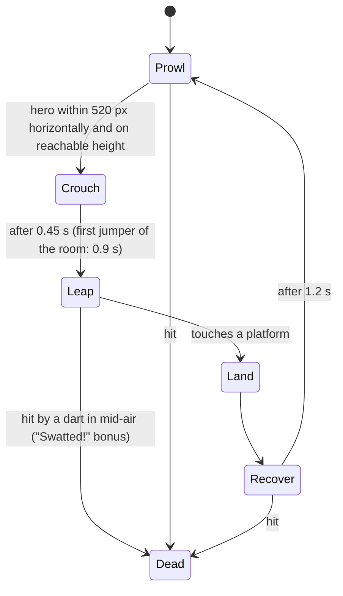

# Prompt 02 — Room 4: the Kitchen (introduces the Jumper)

You are adding Room 4 to the Spyder web game in `E:\Projects\retro-ports\spyder\game\`, together with a new spider type, the **Jumper**. This prompt is written for any coding agent (Claude Code, Codex, Gemini, Kimi). Follow it literally; where something is unclear, choose the option closest to the reference scene and write the decision in `game/rooms/kitchen/NOTES.md`.

**Precondition:** prompt 00 (game shell) has run and the owner approved its hero frames. If `game/lib/room-runtime.js` or `game/rooms/living-room/room.js` does not exist, **stop and report** — do not build the shell yourself.

## Read first (completely)

1. `ART-DIRECTION.md` — binding. §3 palette, §4 painterly technique, §5 composition minimums, §6 lighting, §7 spiders (rig rules and "new types are new brains"), §9 webs, §10 makeover, §15 QA loop, §16 checklist, §17 room bible (row 4).
2. `DESIGN.md` §5, §6 (Jumper: "hops short distances toward the player", first appears in the Kitchen), §8.
3. `game/NOTES.md`, `game/lib/room-runtime.js` (room interface, `rules`, spider-type registry), `game/lib/spider-rig.js`, `game/lib/spiders.js`.
4. `game/rooms/living-room/room.js` — **your template**.
5. `reference/screens/*.jpg` — the quality bar.

## Hard rules

- Create files only under `game/rooms/kitchen/` and **one new file** `game/lib/spider-types/jumper.js`. Shared edits allowed: **two `<script>` lines** in `game/index.html` (jumper, then kitchen) and **one registration line** for the Jumper if the registry needs it. Re-read each shared file immediately before editing and change only those lines (another session may be editing them).
- Do not modify `spider-rig.js`. The Jumper is a **new brain on the same rig**; its look differs only through rig parameters you pass in (scale, per-leg reach/thickness multipliers, markings). If the rig cannot take a parameter you need, wrap or subclass it inside `jumper.js`.
- Do not modify other rooms, `reference/`, or other lib files.
- Paint with `S.paint` — no flat fills, no ruler-straight organic edges; palette only; no per-frame blur; static art cached in `dirty` and `clean` layers.
- Humanized code, seeded randomness. No git commits.

## The room

A 1960s-style family kitchen, abandoned mid-life: things left on the counter, a calendar on the wall, the fridge door not quite shut.

### Layout (stage units, 1920 × 1080)

| Element | Position | Notes |
|---|---|---|
| Ceiling | y 0–100 | Plaster with a crack; spiders drop from y = 100 |
| Upper wall | y 100–440 | Faded wallpaper with a small vintage fruit or gingham motif (low contrast, alpha 0.2–0.3) |
| Upper cabinets | x 90–520 and x 1180–1500, y 150–400 | Painted wood (muted cream-green), glass-fronted on the right with plates visible inside |
| Window over the sink | x 560–860, y 210–480 | Night view (far layer with parallax): garden, washing line, moon; café curtain on the lower half |
| Backsplash | y 440–690 | Square tiles (cream with a few cracked/missing when dirty), grout lines wobbly |
| Counter run | x 100–900, top y 700, base cabinets to the floor | Stove with four burners at x 140–420; sink at x 600–820 under the window with a tap |
| Fridge | x 940–1110, y 300–852 | Rounded 1950s fridge, cream; door **ajar** while dirty, cold light leaking out |
| Kitchen table | x 1260–1640, top y 760 | Checked oilcloth tablecloth, two chairs (one pushed back, one fallen over when dirty) |
| Pendant lamp | over the table, x 1450, shade bottom y 330 | Enamel dome shade on a cord from the ceiling |
| Wall calendar | x 1560–1660, y 180–320 | Turned to an October page, one date circled in red pencil |
| Floor | y 770–1080 | **Checkerboard linoleum** (cream and oxblood, muted) in the same one-point perspective as the reference floor, scuffed and dusty when dirty |
| Foreground | bottom corners | Out-of-focus: a chair back (left), a mop bucket (right) |

### Platforms (≥ 3)

| Platform | Spec |
|---|---|
| Floor | y = 935 |
| Counter | x 110–890, y = 700 |
| Kitchen stool | x 1150–1215, y = 830 (a step up to the table) |
| Table | x 1270–1630, y = 760 |

### Lights (≥ 3 + head lamp)

| Light | Spec |
|---|---|
| **Fridge light** | Cold white-blue wedge spilling out of the ajar door across the floor (cone from the door gap, angle toward the lower right); flickers faintly. After the makeover the door closes and this light goes out — replaced by warm light. |
| Window moonlight | Shaft from the window onto the sink and counter, with dust motes in it |
| **Pendant lamp** | Warm `amber`; **flickers** and **swings** when a dart hits it or a spider lands on the cord (damped swing; light and shadows swing with it) |
| Stove pilot | A tiny blue flame under one burner (small point light, very low intensity) — the only blue-violet accent; it is the pilot light, not a fire |
| Off until the makeover | **Under-cabinet strip light** along the upper cabinets (warm), then the pendant settles steady |

### Webs (≥ 6)

Both top corners; between the upper cabinets and the ceiling; across the window's top corner; under the table between two legs (low — a web the player must aim down for); from the pendant cord to the ceiling; between the tap and the backsplash.

### Dirty → clean (≥ 4, plus story and trace)

1. Copper pans on a wall rack: dull and green-stained → shining copper
2. Broken plate on the floor → plates stacked in the glass cabinet
3. Herb pots on the sill: dead → fresh basil and parsley
4. Fruit bowl on the table: shrivelled → fresh apples
5. Fallen chair → upright and tucked in
6. Cracked/missing backsplash tiles → whole
- **Story object:** a **recipe card** held to the fridge by a magnet, handwritten ("Apple cake — for A., when she visits"). Dirty: curled and stained, unreadable. Clean: flat and readable. Results card: "On the fridge: a recipe card, in a hand you almost know."
- **Calendar:** the circled date stays the same in both states (the house stopped that day); clean state reveals the pencil note next to it: "A. coming!"
- **Trace of the previous cleaner:** an overturned mop bucket with a dried mop, near the fridge. In the clean state it stands upright, empty.

### Unique makeover beat

At t = 3.4 s: the fridge door swings shut with a soft thunk (its cold light goes out), the **tap sputters brown, then runs clear** for 1.2 s (a thin animated stream with highlights, a splash at the sink), then the **kettle on the stove whistles** (a small steam puff rising; whistle sound via Web Audio, two notes gliding up, gentle).

## The Jumper (new spider type)

File: `game/lib/spider-types/jumper.js`, registered as `jumper`. Same `SpiderRig`, new brain.

### Look (silhouette difference only)

| Parameter | Value |
|---|---|
| Scale | 0.9 |
| Back legs (pairs 3 and 4) | Femur 1.4 × thicker, reach 1.15 × longer — reads as "built to jump" |
| Abdomen markings | Pale **transverse bands** instead of chevrons (3 bands, `spiderMark`) |
| Everything else | Rig defaults: IK legs, planted feet, eye glints, pedipalps, breathing |

### Behaviour (state machine)

- **Prowl:** walks along its current surface (floor, counter, table — it lives on platforms, not on the wall), planted-feet gait, stops and twitches like the Wall Crawler.
- **Crouch (the telegraph, must be readable):** body lowers (squash 15 %), legs pull in, the two front legs lift and wave, a small dust puff at its feet, a short rising hiss. Players must always be able to see a leap coming.
- **Leap:** ballistic arc toward the hero's position **predicted 0.3 s ahead**, gravity 2200, flight 0.55–0.8 s; legs splay outward in the air; a faint motion streak.
- **Land:** on any platform it crosses; landing within 50 px of the hero = hurt 12 and hero `disgusted`; landing kicks up dust and a small thud.
- **Shot mid-air:** +100 bonus labelled "Swatted!" on top of its points (180 base), and it tumbles.
- Spawns from: **under the fridge**, **behind the stove**, and **out of the sink drain** (it climbs over the sink edge onto the counter).

### Kitchen rules

`quota: 18`, `webGoal: 0.85`, `types: ['string', 'crawler', 'jumper']`, `spawnPattern: ['string', 'jumper', 'string', 'crawler', 'jumper', 'string', 'crawler', 'jumper']`, `maxAlive: [3, 4]`, `spawnInterval: [2.4, 1.3]`. The first Jumper of the room spawns alone (no other spider alive) with the slow 0.9 s crouch, so the player learns it.

## QA loop (mandatory — ART-DIRECTION §15)

QA URL `game/index.html?qa=1&room=kitchen` with `setup('dirty'|'action'|'makeover'|'clean'|'results')` plus `setup('jumper')`: one Jumper **frozen mid-leap** at the top of its arc above the table, legs splayed, hero below aiming at it, fridge light and pendant visible.

Every round: render all states, compare side by side with `reference/screens/`, list the **5 biggest quality gaps** in `game/rooms/kitchen/NOTES.md` (typical: tiles and linoleum reading as flat grids, fridge light too weak to read as a cold wedge, cabinets flat, Jumper not distinguishable from the String Spider at a glance, crouch telegraph too subtle), fix, render again. **At least 3 rounds.** Then play the room start to finish once and confirm: first Jumper alone with slow crouch, mid-air swat works, makeover with the tap and kettle, results, map shows CLEAN.

## Hero-frame checkpoint — STOP here

Save to `game/rooms/kitchen/screens/` at 1920 × 1080: `dirty.png`, `action.png`, `jumper.png`, `makeover.png`, `clean.png`.

Stop and report: files created, the shared lines added, the QA notes per round, and the five frames. **Do not continue to another room.**

## Acceptance (ART-DIRECTION §16 plus)

- [ ] All 15 checks of ART-DIRECTION §16
- [ ] Reads instantly as a kitchen: counter, sink under the window, fridge, table, pendant
- [ ] Checkerboard floor in correct perspective; tiles with wobbly grout
- [ ] Fridge cold light ↔ warm pendant gives a clear cool/warm contrast while dirty
- [ ] Jumper: distinct silhouette, readable crouch, predicted leap, mid-air swat bonus, lives on platforms
- [ ] Unique beat: fridge shuts, tap runs clear, kettle whistles
- [ ] Results card names the story object (recipe card)
- [ ] No console errors; ≤ 8 ms/frame on GPU canvas; no per-frame blur
