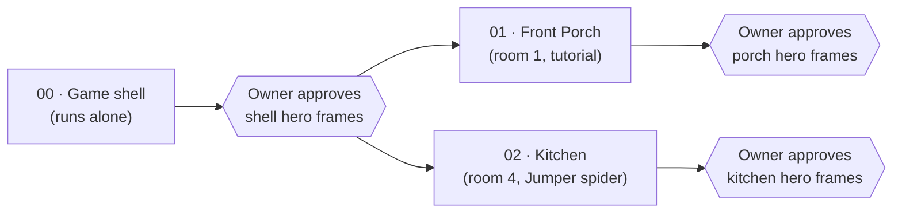
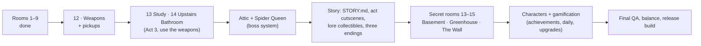

# Spyder — build prompts

> **Workflow from prompt 03 onward:** the owner opens **Claude Code (Opus 5.5)** in this folder and says *"Read prompts/CLAUDE-CODE.md and follow it."* Claude Code runs each prompt through Gemini (`agy`, via `run-agy.ps1`), reviews the one review sheet the prompt asks for, and reports. It does not repeat Gemini's QA.

Prompts for the coding agent (Claude Code, Codex, Gemini CLI / Antigravity, Kimi Code — any of them). Each prompt is self-contained: open a fresh session in `E:\Projects\retro-ports\spyder` and say:

> Read `prompts/NN-<name>.md` and carry it out.

## Run order

| # | Prompt | Runs | Owns `game/lib/` changes? | Status |
|---|---|---|---|---|
| 00 | `00-game-shell.md` | **Alone**, first | Yes (creates it) | Done, reviewed |
| 01 | `01-front-porch.md` | After 00 is approved; may run **in parallel** with 02 | No — may add files under `game/rooms/front-porch/` only | Done, reviewed |
| 02 | `02-kitchen.md` | After 00 is approved; may run **in parallel** with 01 | Only the **new** file `game/lib/spider-types/jumper.js` and its registration line | Done, reviewed |
| 03 | `03-polish.md` (+ `-fix-1`, `-fix-1-finish`) | **Alone** | Yes (eggs, makeover blend, runtime requests); also `reference/` for eggs + blend | Done, approved |
| 04 | `04-review-folder.md` | **Alone** | Tools only (`review.mjs`), no game changes | Done, approved |
| 05 | `05-family-room.md` (+ `-fix-1`) | After 04; **parallel** with 06 | No — `game/rooms/family-room/` only | Done, approved (art redone by Opus) |
| 06 | `06-dining-room.md` (+ `-fix-1`) | After 04; **parallel** with 05 | No — `game/rooms/dining-room/` only | Done, approved (art redone by Opus) |
| 07 | `07-polish-2.md` | **Alone** | Yes: two-file rooms + blockout; reference sync (hatchlings) | Done, approved (Flash logic, Opus art) |
| 08 | `08-downstairs-bathroom.md` | After 07; **parallel** with 09 | No — its room folder only | Done, approved (Flash logic, Opus art) |
| 09 | `09-upstairs-hallway.md` | After 07; **parallel** with 08 | Only the new `spider-types/egg-carrier.js` + one exported helper in `spiders.js` | Done, approved (Flash logic, Opus art) |
| 08-fix-1 | `08-downstairs-bathroom-fix-1.md` | **Alone**, quick | No | Done, approved (Opus) |
| 10 | `10-master-bedroom.md` | After 08-fix-1; **parallel** with 11 | Yes: `rules.extraGoals` on the work order | Done, approved (Flash logic, Opus art) |
| 11 | `11-kids-bedroom.md` | After 08-fix-1; **parallel** with 10 | No | Done, approved (Flash logic, Opus art) |
| 12 | `12-weapons.md` | **Alone** | Yes: weapons, pickups, unlocks, HUD tags | Done, approved (Flash logic, Opus art; split into briefs) |
| 13 | `13-study.md` | After 12; **parallel** with 14 | Yes: `world.addWeb` + the Web Weaver type | Done, approved (Flash logic, Opus art) |
| 14 | `14-upstairs-bathroom.md` | After 12; **parallel** with 13 | No | Done, approved (Flash logic, Opus art) |
| 15 | `15-boss-system.md` | **Alone** | Yes: boss framework, makeover pre-warm | Queued |
| 16 | `16-attic.md` | **Alone**, after 15 | Yes: `lib/bosses/spider-queen.js` | Queued |
| 17 | `17-lore-scrapbook.md` | Parallel with 18, after 16 | Yes: progress, house map, new Scrapbook screen | Queued |
| 18 | `18-cutscenes.md` | Parallel with 17, after 16 | Only `game/cutscenes/` + trigger hook | Queued |

### Roadmap (architect's order)

Why this order: weapons change the runtime and every later room should be designed with them; the Attic boss needs a boss system before the story can climax; the cutscenes and endings need all three acts in place; the secret rooms hang off collectibles from the story pass; characters and gamification tune a game that is otherwise complete.

**[LOGIC] / [ART] tags:** from 07 on, every section is tagged. With Gemini 4 Argon, one run does both. If Argon's quota is used up, Gemini 3.8 Flash does only [LOGIC] (`run-agy.ps1 -Scope logic`) and Claude Code (Opus) paints the [ART] parts. Flash never paints.

**Where to review:** open `review/index.html`. Every prompt from 04 on leaves exactly one `sheet.jpg` and one `summary.md` in `review/prompts/<NN-name>/`, and the latest frames of every room in `review/current/`. Nothing else keeps images (see `ART-DIRECTION.md` §15).

When 01 and 02 run in parallel, both add `<script>` lines to `game/index.html`. Each prompt tells the agent to re-read the file right before editing and insert only its own line. If one session reports a conflict, paste this into it: *"Re-read game/index.html now and re-add only your own script line(s); do not change anything else."*

Every prompt ends at a **hero-frame checkpoint**: the agent renders the frames, critiques them for at least 3 rounds, then **stops and waits for the owner**. Do not tell an agent to continue past that point until you have looked at the frames (or asked Claude to review them).

## What every prompt relies on

- `ART-DIRECTION.md` — the binding visual rules (numbers, palette, pipeline, QA loop, acceptance checklist).
- `reference/` — the playable Living Room and its six reference frames in `reference/screens/`. This is the quality bar.
- `DESIGN.md` — gameplay.

## Assumption made for these prompts

`DESIGN.md` §12 leaves "linear or free room order" open. The shell builds **linear unlocking with free replay of cleared rooms**. Changing this later only touches the house map screen.
